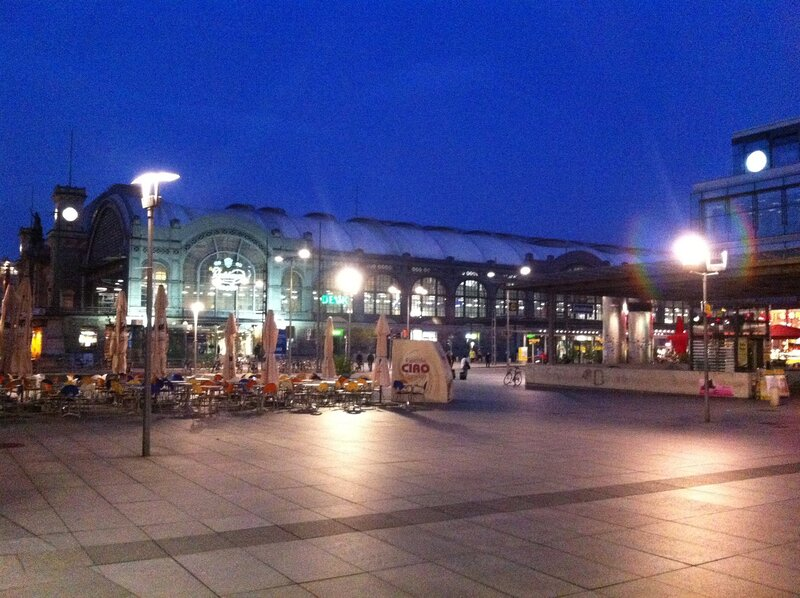
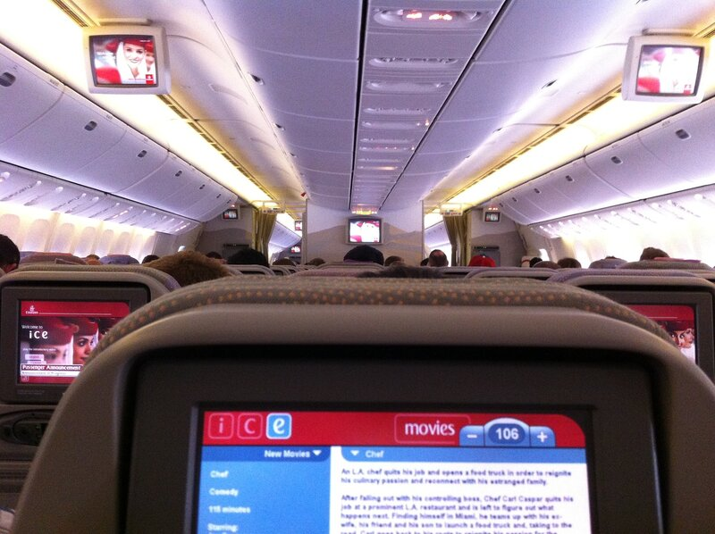
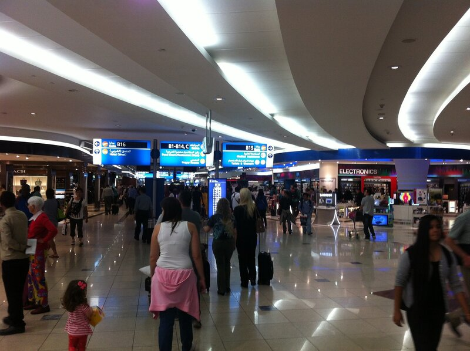
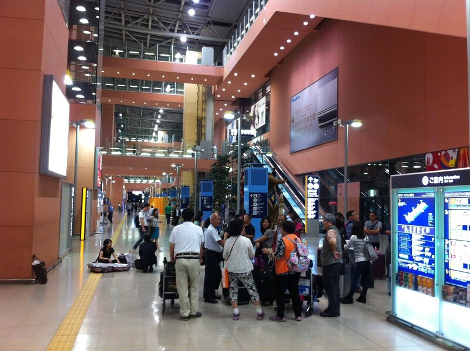
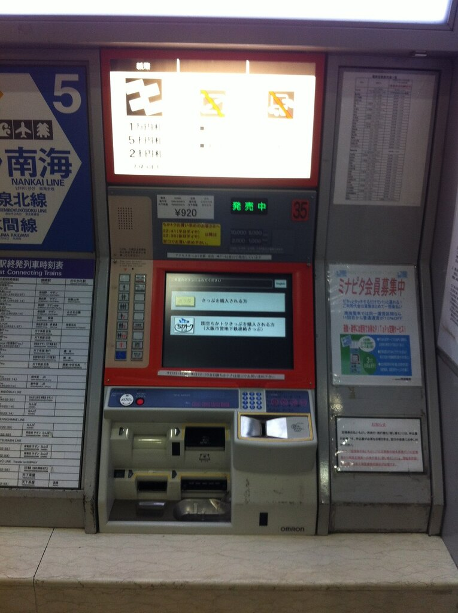
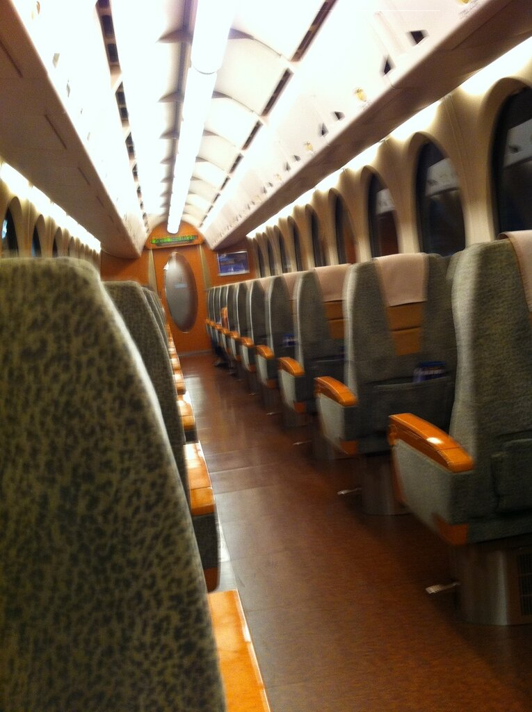
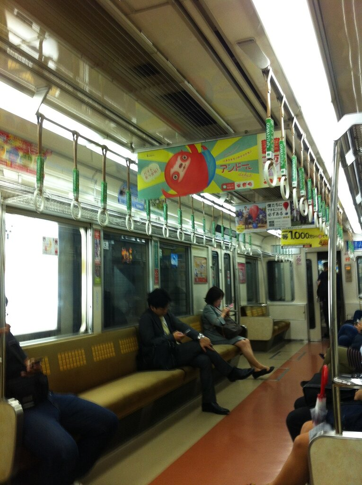
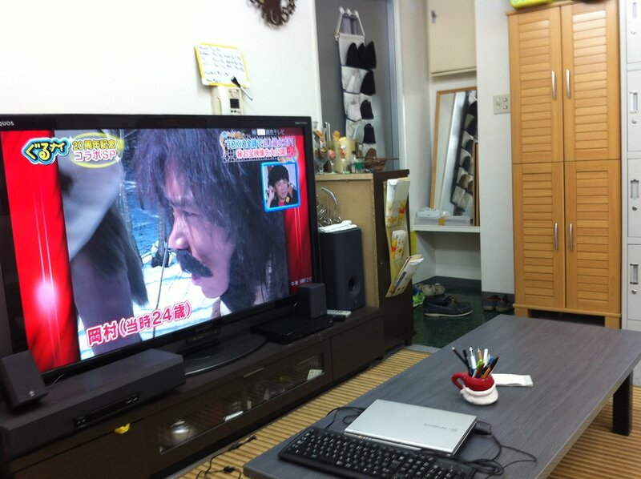

Итак, было решено приехать в Японию за неделю до начала учебы, которая должна стартовать 1 октября. Билеты, как ни странно, можно купить вполне неплохие за ~700 евро туда-обратно, причем не самой плохой авиакомпании — Emirates. Место вылета — Гамбург, потом пересадка в Дубайске :-), а оттуда уже в Осаку. Так как после того, как мы уже купили билеты на 24 сентября, нам сообщили, что общежитие в Окаяме будет предоставлено только с 1 октября, появилась неплохая возможность остановиться на несколько дней в Осаке, оклиматизироваться, посмотреть окрестности. Мы — это я и мой одногруппник по имени Маркус, который, как не сложно догадаться, родом из Германии.

Между тем, до Гамбурга необходимо добраться из Дрездена с пересадкой в Берлине, поэтому день перелета начинается рано: поезд из Дрездена до Берлина отходит в 7 часов утра. Вокзал Дрездена в полседьмого:

Emirates предоставляют замечательную услугу rail and flight, благодаря которой билеты на поезд до аэропорта из любой точки страны ты получаешь бесплатно в дополнение к авиабилету. Не знаю, работает ли это в других странах, но в Германии — да.

За примерно 6 часов, сделав 2 пересадки, мы добираемся до аэропорта Гамбурга, где успешно сдаем багаж и проводим некоторое время дожидаясь рейса, который задерживают на час. Немного подождав, мы — в наконец загружаемся в Боинг. Впервые лечу на самолете со встроенными в переднее сиденье мониторами. Можно посмотреть кинцо, послушать какую-то музыку, даже олдскульные восьмибитные игры есть. Места для ног предостаточно, и можно спокойно и с комфортом долететь.

Через 6 часов мы в прилетаем в Дубаи. Аэропорт действительно большой, как я слышал из рассказов, но ничего сверхъестественного или шикарного я не наблюдаю. Просто огромный транспортный узел с черепашьим фривайфаем, толпами людей, снующих от одного магазина к другому. Такой современный базар.

Посидели пару часов, чай попили — летим дальше. Следующий рейс до Осаки длится 9 часов, 7 из которых я провожу в подвешенном состоянии неспокойного сна. В самолете в основном — японцы, от тех, что сидели по обе стороны от меня, я за 9 часов не услышал и звука. Очень непривычно.

Уже уставшие от долгой дороги, мы прилетаем в Осаку, 25 сентября 17:00 по местному времени, уже темно, но очень тепло, примерно 25 градусов. Нас ведут на паспортный контроль, и все проходит достаточно мило и быстро. Голова, тем не менее, уже плохо соображает, когда понимаем, что впереди самый сложный участок пути — дорога до хостела.

Аэропорт Осака достаточно мил.

Из аэропорта на быстром поезде нужно добраться до одной из станций метро, а там уже и рукой подать до душа и кровати.

С покупкой билета в автомате на экспресс-поезд мы не справились и обратились в кассу с живым человеком, который предложил нам 2 варианта, немного различные по цене. Купили билеты подороже примерно 1150 йен за штуку, зато на быстрый поезд.

Такой автомат

Поезд оказался почти пустым и комфортным.

Стоит отметить, что люди в метро часто останавливались, заметив наши недоуменные лица напротив автоматов для покупки билетов, и предлагали помощь. Так мы купили билеты на метро, уточнив как узнать стоимость билета у такого вот доброжелательного молодого человека. Метро выглядит достаточно чистым, посторонние запахи отсутствуют 🙂

От метро до хостела, который был найден, идти 5 мин, добрались быстро, нас встретил доброжелательный хозяин Тоши, все объяснил и показал. Хостел состоит из 2-ух комнат: одна — гостиная-кухня, вторая — большая комната с 6-ю двухэтажными кроватями. На момент приезда помимо нас было 2 человека. Вероятно, загулявшиеся туристы придут ночевать попозже =)

Ну а я пойду посплю прямо сейчас.
