Итак, путь мой начинался из Окаямы, откуда мне сначала необходимо было добраться до аэропорта Осаки. В Окаяме тоже есть аэропорт, но он совсем небольшой, и интересующих меня направлений не нашлось в расписании. Из Осаки же летают бюджетные авиалинии Peach, у которых четырехчасовой перелет до Гонконга стоил мне примерно 70 евро. Однако, расписание не совсем удобное: вылет в 8:45 утра, а ведь до Канзай аэропорта Осаки еще и доехать надо. Решил в итоге выехать на день раньше, спокойно переночевать в Осаке и сутра двинуть в аэропорт свежим и отдохнувшим. Получилось не совсем так, но все по порядку.

До Осаки из Окаямы дешевле всего добраться автобусом, 3-4 часа в пути, автобусы достойные. Одна остановка в пути на 15 минут размять ножки и прочее. Можно, конечно же, воспользоваться скоростным всеми любимым поездом Шинкансен, который домчит примерно за час, но ценник увеличится больше чем в двое. У студента времени много, а денег не очень, поэтому автобус – то что нужно. Ну и видами полюбоваться лишний раз из окошка.

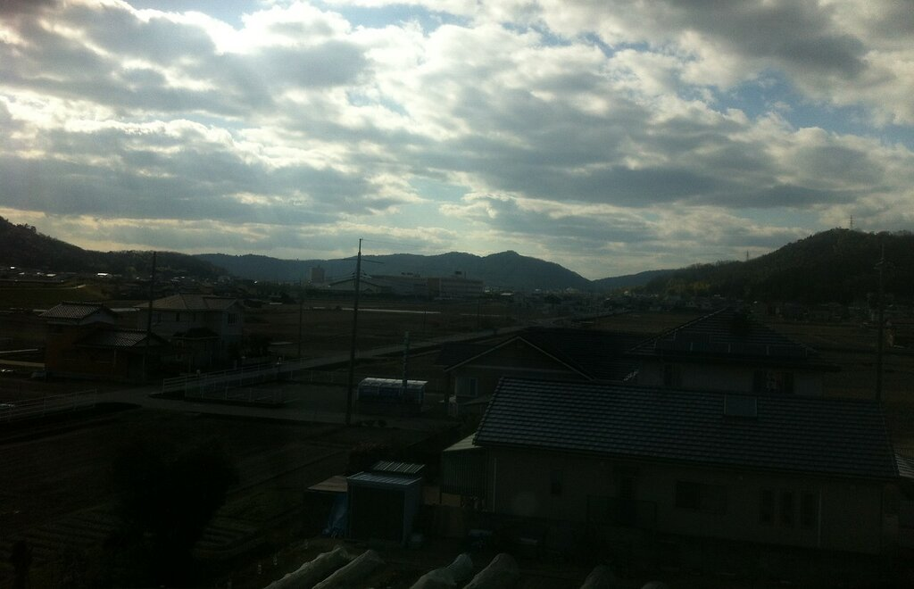

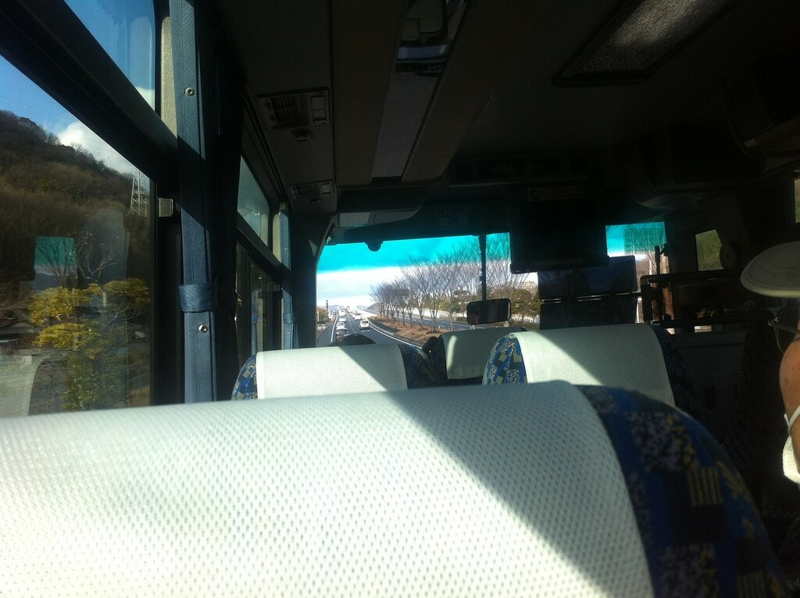

Довольно быстро доехал до центральной станции Осаки, залетел в железнодорожный вокзал, спросил в информационной стойке, как добраться до нужной мне станции, где обосновался мой хостел, стоимостью 15 евро за ночь в районе Shinimamiya, что как раз по пути в аэропорт. Прыгнул в поезд, доехал до станции, вылез из вагона и вышел на улицу. Тут-то и началось. Здание хостела располагалось метрах в 400 от входа в станцию. То есть пройтись слегка по спокойной улице. Единственный момент, что по пути из 30 человек встреченных мной, человек 25 были, скажем так, бездомные. Такого я, мягко сказать, не ожидал увидеть тут. Заселился в хостел, типа отдельная комната, достаточно потертая, зато с телевизором с прон-каналом, туалет и душ общие, один на этаж.

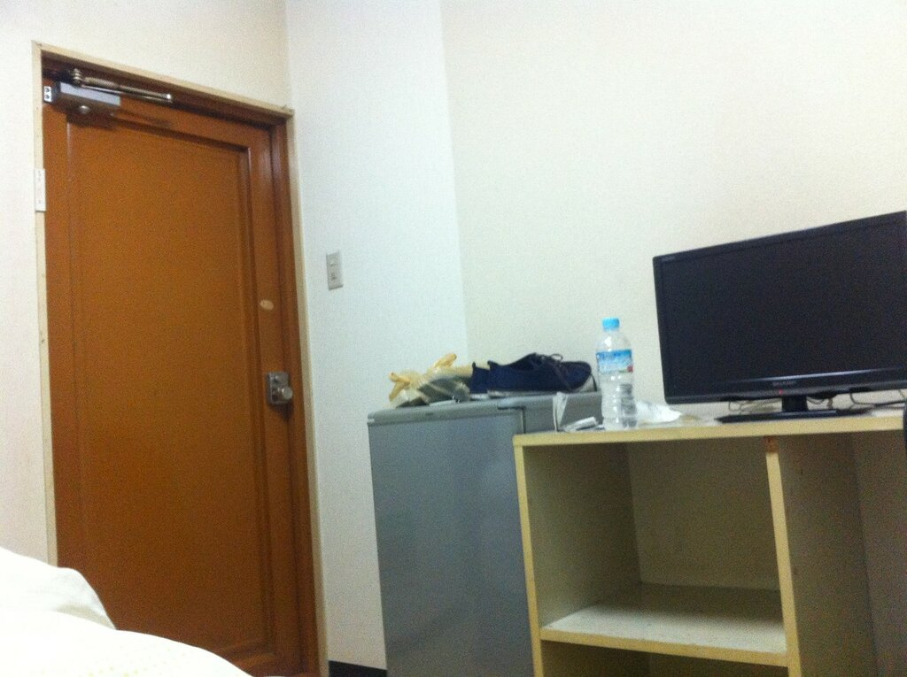

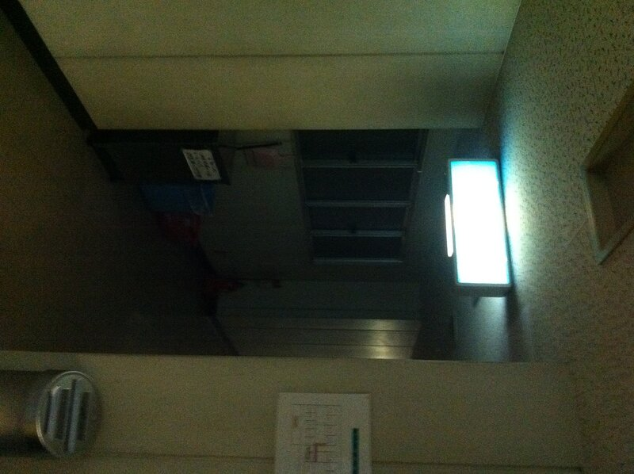

Типа на входе в хостел

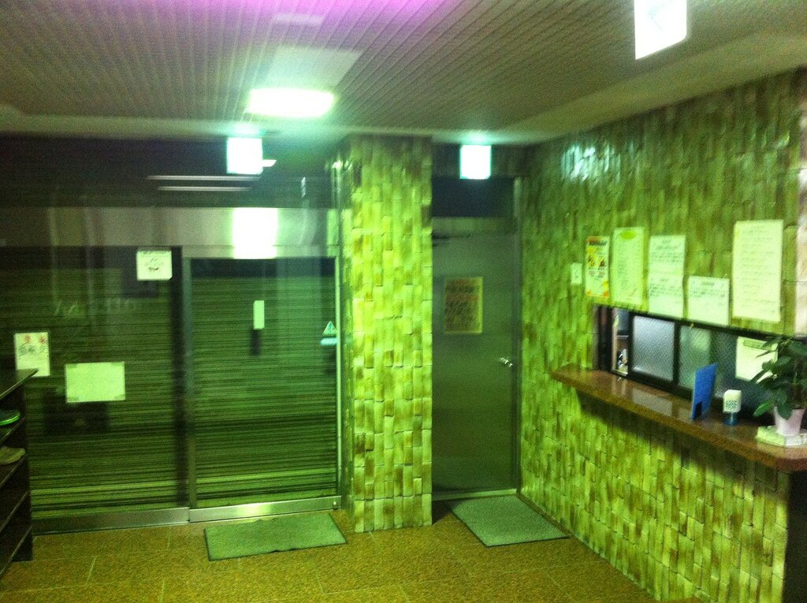

Сбегал в комбини (небольшой круглосуточный магазин типа 7/11) купить поесть – окружение не поменялось, люди спящие на тротуаре, отрешенно шатающиеся в поисках алкоголя или новых приключений. Настоящее хобо-гетто, кароч, ощущение, что зомби-апокалипсис наступил прямо тут прямо сейчас. Думаю, ладно, выдвигаться в 5 утра, все норм. Однако, поспать хорошо не получилось, видимо перед путешествием немного перевозбужден был. Да и хоромы слегка удручали

Выхожу на улицу в 5 утра, ну понятно, количество вурдалаков увеличилось в несколько раз. Не знаю, может им там еду бесплатно раздают или наливают. Но вот все эти люди вдалеке на фото, это именно они. Места с наибольшим скоплением персонажей не стал фоткать, никто ж не знает, какую реакцию может вызвать у замерзнувших японских бомжей фотографирующий гайджин в такую рань. Может кто-то из них встал не стой ноги, лучше не рисковать.

Да, да, все эти ребята впереди играют в одной команде

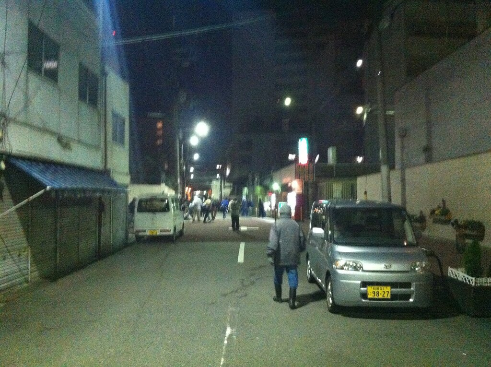

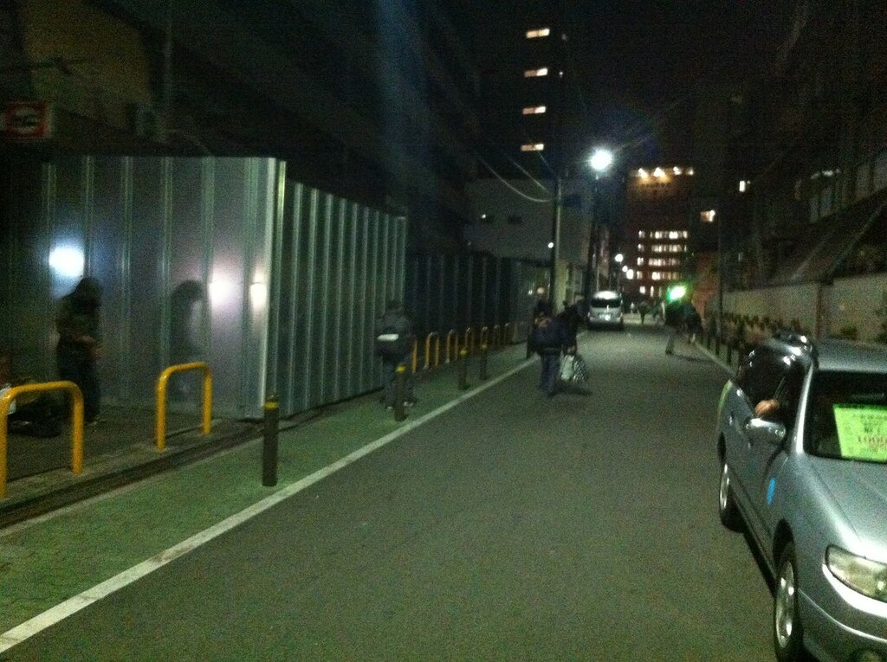

Еще немношк ужасов

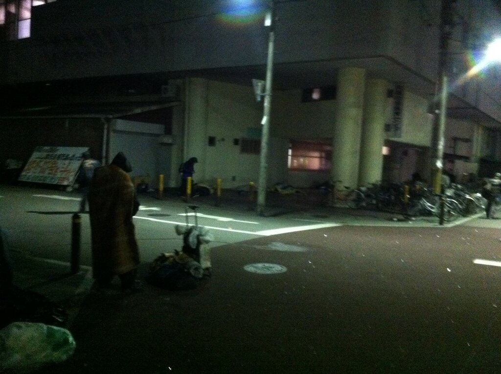

Допрыгал до пустующей станции, купил билет на поезд до аэропорта, тут все спокойно

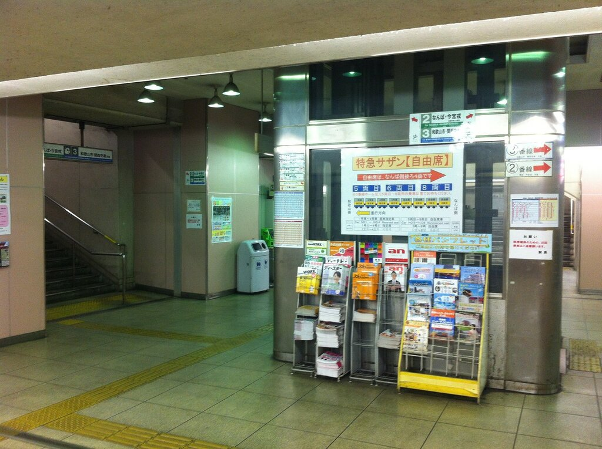

Через 40 минут уже искал свой запрятанный далеко-далеко отдельный терминал, в котором разместились авиалинии Peach.

После ночи без сна, четыре часа в неудобных креслах и совершенное отсутствие места для ног (это когда колени упираются впереди стоящее сиденье и вообще никак не пошевелиться) организовали мне небольшую головную боль, но проблема была решена наблюдение туманных пейзажей Гонконга и посещением переполненного чуть более, чем полностью Макдональдса в аэропорту.

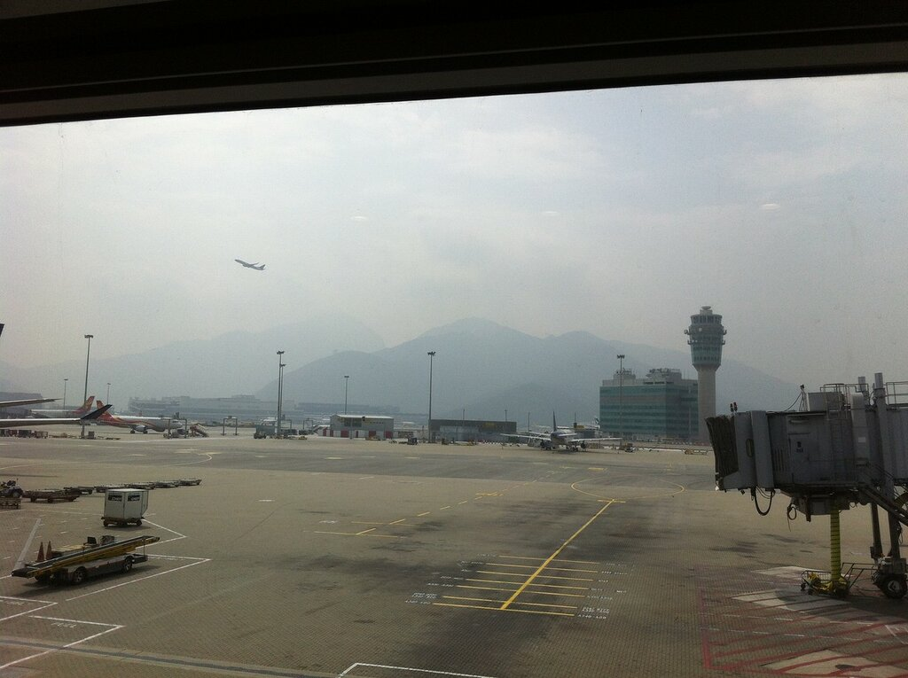

Много людей-то в Гонконге

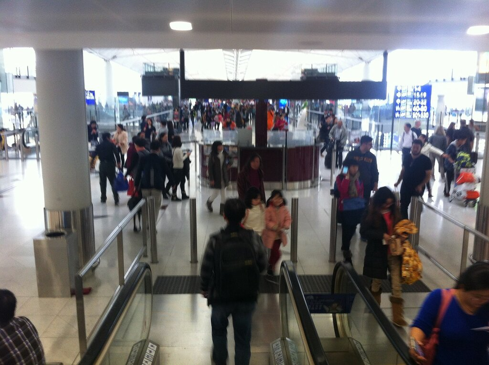

В Гонконг я еще вернусь на 3 дня, а сейчас на стойку и чекиниться на вьетнамский рейс до Ханоя. Вьетнамские авиалинии уже не такие бюджетные, соответственно, гораздо приятнее. А какие у них стюардессы =)

Из Ханоя последний на тот день короткий перелет в Нячанг

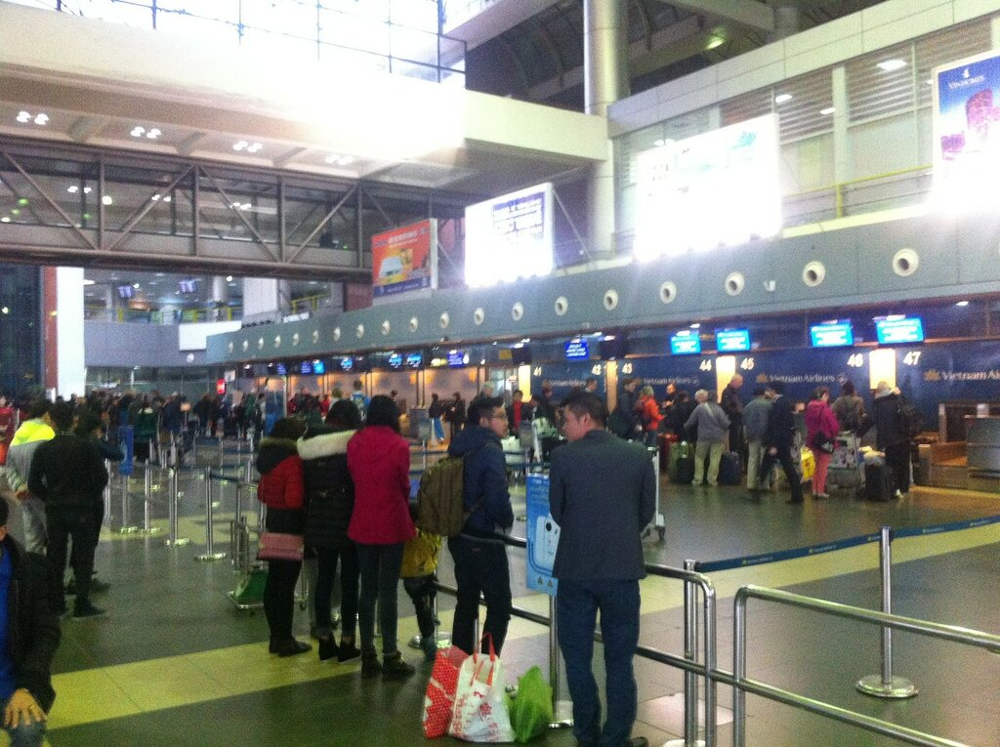

В зале ожидания все на расслабоне, местным можно и цыгарку посмолить

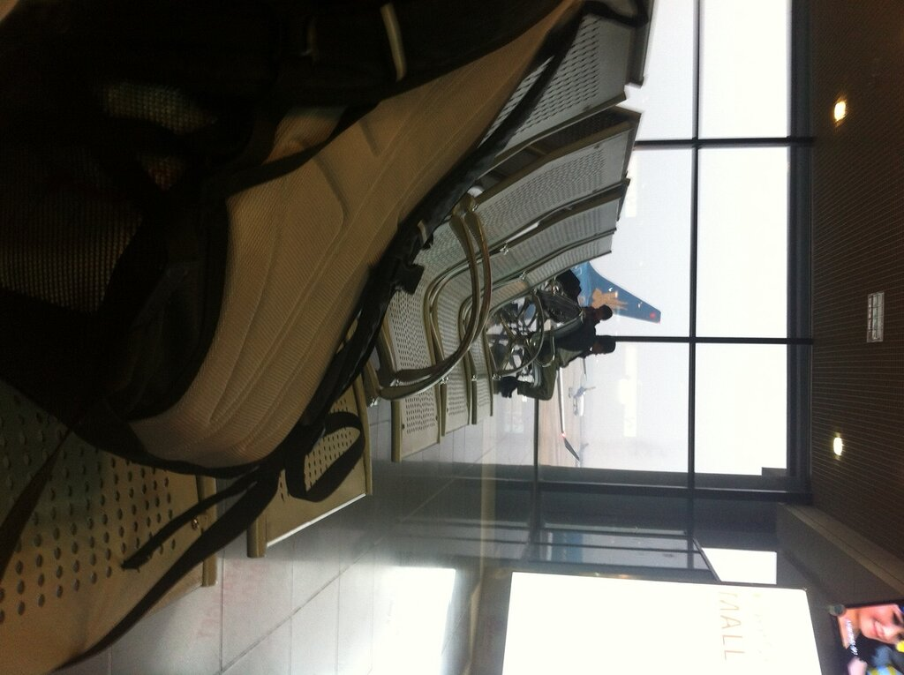

Где то в районе 9 вечера я оказался в своем чудо-отеле без окна. Спишь зато как убитый =) Кстати на заметку: если сами бронируете дешевые отели во Вьетнаме, то уделяйте этому моменту особое внимание, на букинге обычно указано, что номер с окном, и будет на пару монет дороже. Так вот у них строят дома. Меня отсутствие окна не напрягало вообще, главное что чисто и есть какой-то завтрак, поэтому прожил я там прекрасных 9 ночей, о которых позже.
