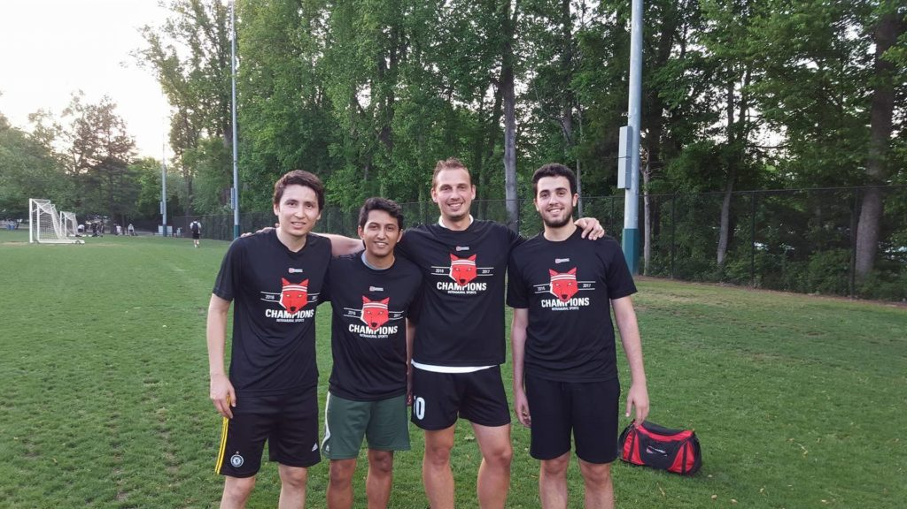

Понятно, что в США футбол или соккер — далеко не самый популярный вид спорта. Впереди бейсбол, американский футбол, баскетбол и хоккей. Однако, по посещаемости стадионов МЛС — американская футбольная лига, далеко впереди РФПЛ — Российской Премьер Лиги. Вот тут можно почитать про [посещаемость МЛС](https://www.championat.com/football/article-231133-poseshhaemost-mls-v-detaljakh.html). Невероятно, что у некоторых команд 100% показатель на домашних встречах: народ любит и ходит на футбол поболеть, пообщаться, отдохнуть. В этом отношении, нам — как до звезды. Но не буду о грустном, расскажу о житейском.

Итак, понятно, что футбол здесь, как минимум популярен не менее, чем у нас. А вот если я — любитель и хочу сам играть, а не смотреть? Варианты есть, нужно только поискать.

**Платно**

**Большой футбол**

Мне посчастливилось познакомиться с русскоговорящими людьми в Северной Каролине, которые еще и в футбол играют. В Северной Каролине существует [любительская футбольная лига](http://www.tasl.us/) — типа нашей ЛФЛ, с разными дивизионами. Играю в одном из низших дивизионов, в команде есть пара американцев и месиканцев, а так же много выходцев из постсоветского пространства. Мы принимаем участие в осеннем и весеннем чемпионатах. Время проведения: август-ноябрь и февраль-май, соответственно. Игры проходят раз в неделю, обычно в субботу, на одном из многочисленным полей: каждый раз место игры разное. В Роли, например, есть даже целый Соккер Парк, в котором примерно 20 полноразмерных футбольных полей. Здесь очень мягкий климат, поэтому трава растет круглый год. Большинство полей с натуральным газоном. Качество газона, правда, иногда страдает, поэтому пару раз пришлось играть на огороде. Есть одно поле с искусственной травой — мне там удобнее всего. Игра проходит по всем правилам: два тайма по 45 минут, есть главный судья и два боковых для фиксации офсайдов. Сезон примерно из 10 игр стоит 90-120$: стоимость варьируется индивидуально: первый сезон — 90, второй — 120, третий — опять 90 и так далее. В первый сезон меня заявили позднее — я платил по 15$ за игру + сама регистрация на сайте: 30$ если мне память не изменяет. Обязательна амуниция: необходимо иметь щитки и гетры. Без них играть судья не разрешит. Уровень футбола не самый высокий, но видел игры высших лиг — там в порядке игрочишки.

**Футбол в зале**

Есть как минимум две лиги, где играют в футбол в помещении. Я учавствую в [одной](https://xl-soccer-world.ezleagues.ezfacility.com/default.aspx) из них. Весь прикол в том, что у американцев свое представление о зальном футболе. Я так понял, что они почему-то игнорируют давно изобретенный [футзал](https://ru.wikipedia.org/wiki/%D0%9C%D0%B8%D0%BD%D0%B8-%D1%84%D1%83%D1%82%D0%B1%D0%BE%D0%BB), а играют во что-то среднее между хоккеем и футболом. То есть площадка оборудована бортами, и ауты считаются только, когда мяч за перелетает через борт. Ворота как бы встроены в площадку при этом. Помню во дворе 26 дома на Кутузовском проспекте видел такое. На полу постелен искусственный газон, причем не самого лучшего качества. Ну и плюс куча маленьких правил вдобавок. Экзотика, однако. Приходится довольствоваться этим. Стоимость тут зависит от количества народа в команде. Так за 9 игр я заплатил 80$, соответственно, за команду из 12 человек вышло ~1000$ за летний сезон. Также гетры с щитками обязательно. Судейство есть, но его качество сильно хромает.

**Бесплатно**

Условно бесплатно в университете устраивают турниры по футболу 3х3, 5х5 и классика. Условно — потому что все студенты платят каждый семестр деньги, назовем этот платеж комиссией. В эту комиссию входит почти все текущие траты универа, насколько я понимаю. Например, ты не пользуешься тренажерным залом — но все равно за него заплатишь.

В общем, платить вроде как не надо: регистрируйся онлайн, и — вперед! Нужно только хорошую команду найти. Мне это удалось: мы с парнями выйграли турнир 3 на 3, за что нам вручили по футболке. Я свой приз потерял через полчаса: так и не понял, где и как.

Бесплатно можно поиграть, просто прийдя на поле рядом с универом. Здесь это называется пикап гейм. Если погода хорошая, то на поляне обязательно будут игроки. Качество игры обычно низкое, приходят и играют все подряд, не только студенты. Некоторые входят в игру без спроса — и это нормально тут.

Для игры поинтереснее но на другом поле существует [фейсбучная группа](https://www.facebook.com/groups/226665817504797/). Тут уже уровень игроков повыше, все более менее организованно. Большинство людей знают друг друга. Естественно, американцев не так много, среди игроков преобладают африканцы-эмигранты. Пару недель назад в выходной собралось примерно 40 человек. Все поделились на 4 команды и сыграли чемпионат: каждая из команд сыграла с остальными по матчу. Было интересно.

Оба поля принадлежат университету, поэтому за газоном ухаживают, и обычно он в отличном состоянии.

Футбол — моя любимая игра, поэтому мне крайне важно играть на регулярной основе. Помогает перезагрузить мозг и выплеснуть негатив. Рад, что есть хотя бы такие варианты.
