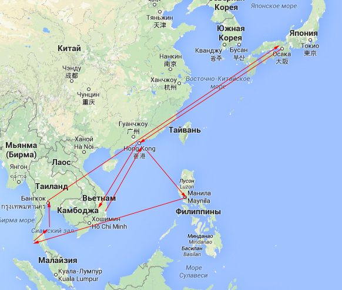
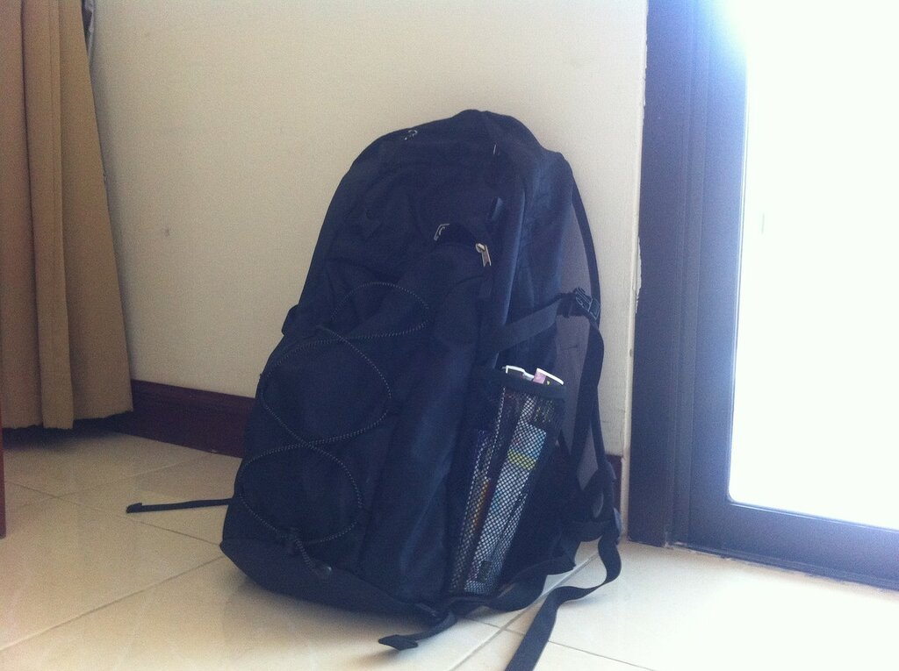

Я до конца думал, стоит ли выкладывать здесь информацию не о Японии, но все ж решил поделиться своими наблюдениями и маленьким опытом о поездке по четырем странам юго-восточной азии. Думаю, что многие люди при планировании отпуска, смогут почерпнуть некоторую полезную информацию о парочке веселых мест, которые мне посчастливилось посетить в феврале-марте 2015 года.

Начнем по порядку: маршрут путешествия. Выбирался по принципу «куда русскому не нужна виза». С этой точки зрения в юго-восточной Азии для туристов из Великой Непобедимой Державы созданы прямо таки тепличные условия для прогрева филейных частей тела на живописных просторах многочисленных пляжей. Выбор пал на 4 страны: Вьетнам, Гонконг (не совсем страна, но Китаем тож не назовешь), Филиппины, Тайланд. Итак, собственно карта для наглядности

По карте как-то получилось нелегко понять, чего и куда, поэтому распишу немношк

06.02 Выезд из Окаямы в Осаку. Ночь в Осаке. Автобус

07.02 Перелеты Осака-Гонконг (Peach airlines), Гонконг-Ханой, Ханой-Нячанг (Vietnam airlines). Отдых начался!

16.02 Перелет Нячанг-Хошимин (Vietnam airlines), вечер и ночь в Хошимине

17.02 Перелет Хошимин-Гонконг (Vietnam airlines), 3 дня в Гонконге на китайский нг

20.02 Перелет Гонконг-Манила, Манила-Калибо (Cebu pacific). 7 ночей на Боракае

27.02 Перелет Калибо-Манила, Манила-Пхукет (Cebu pacific). 4 ночи на Пхукете

03.03 Переезд на Самуи. Автобус и лодка. Расслабон 5 ночей, включая Full moon party

08.03 Переправа+перелет Самуи-Бангкок (Nokair), пару дней в мясорубке, чтоб вернуться к жизни =)

11.03 Перелет Бангкок-Осака (Airasia)

Привет, Япония и новый семестр!

Перелеты выбирались наиболее дешевые, поэтому в основном бюджетными авиалиниями, если интересно, могу, конечно же, расписать по ценам. Из сумок – рюкзак, чтоб не платить за багаж естественно и не таскать чемоданище. Рюкзака, как оказалось вполне достаточно для месяца путешествий, ибо постираться можно везде и недорого.

В путешествие я отправился не один, а с моим немецким коллегой Маркусом, который присоединился ко мне после Вьетнама, начиная с Гонконга. Во Вьетнаме время проводил с ребятами – бывшими коллегами и их другом. Там же совершенно оказалась и еще одна бывшая коллега, которая, узнав про план моего путешествия, решила составить нам с Маркусом компанию, и покаталась с нами аж до самого Пхукета. Так все как-то случайно и весело сложилось.

Пишу я уже по прошествии некоторого времени, а именно, из Тайланда. Вероятно, некоторые вещи успел позабыть, все смешалось, но эмоции от этого отдыха останутся на всю жизнь. Пускай даже маршрут выбран по, скажем так, очень сильно туристическим местам, с толпами пакетников и хитрыми местными, зарабатывающими на отдыхающих, всегда можно открыть что-то новое и встретить интересных людей повсюду и в неожиданных местах.

Начну с дороги в аэропорт Осаки и перелет во Вьетнам, но после.
