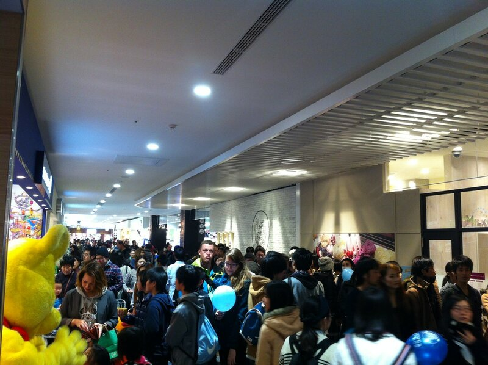
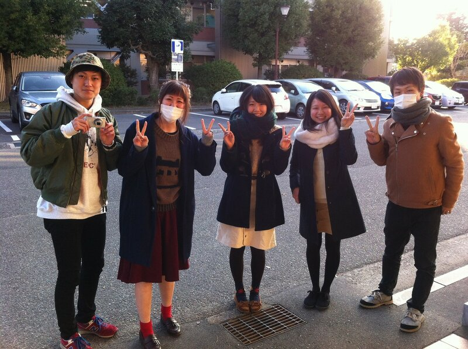
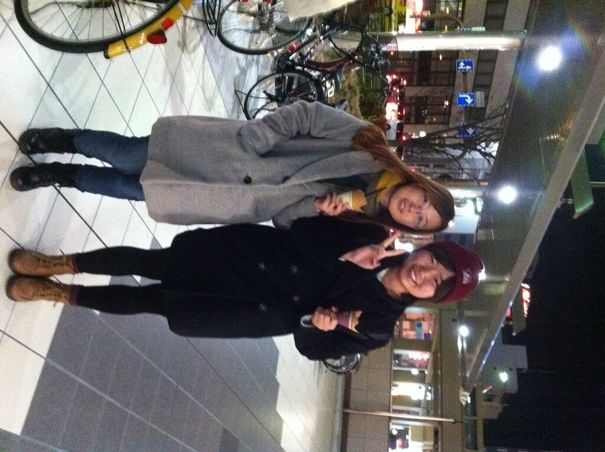
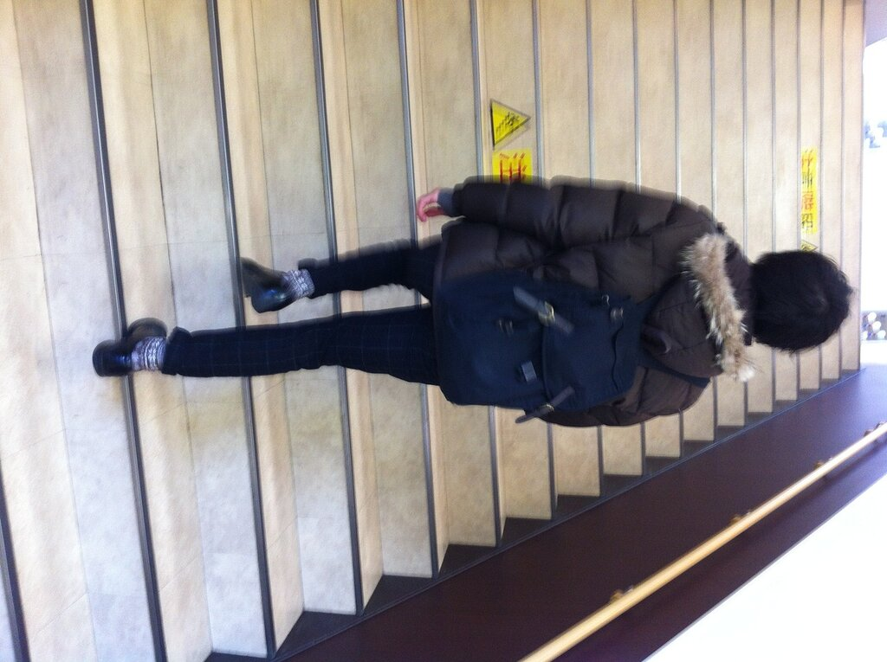
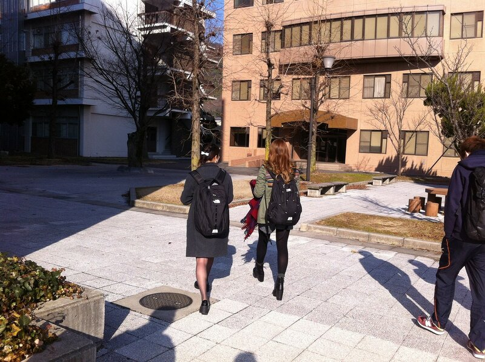
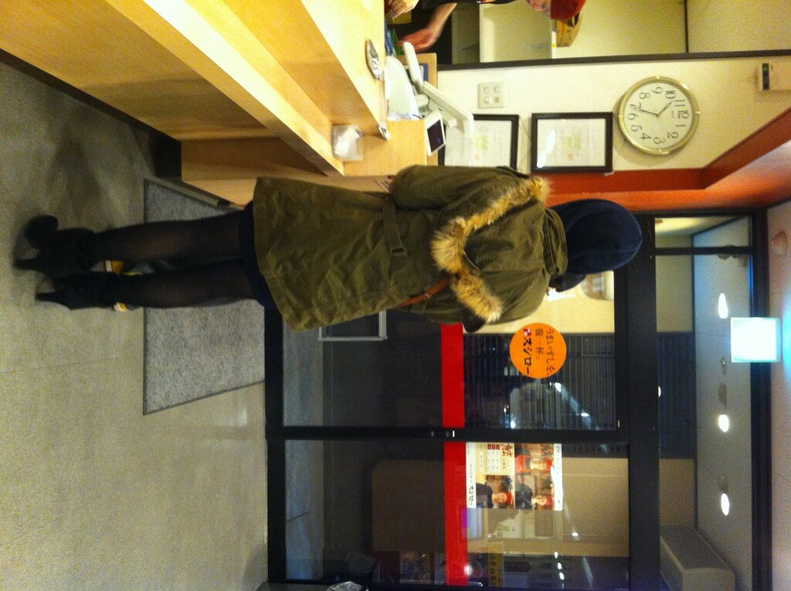
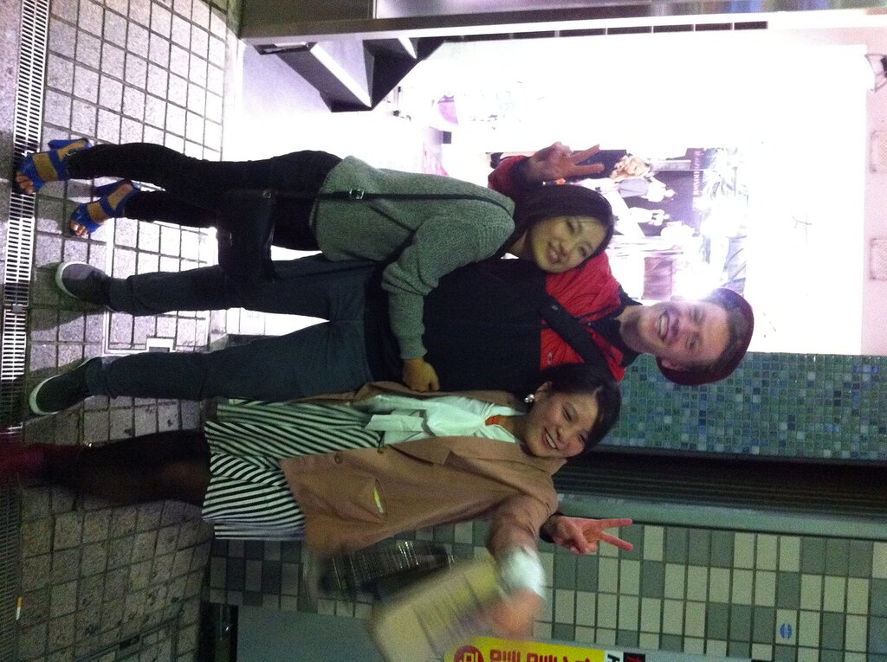

Всех с Новым годом! 🙂

Сегодня постараюсь немного написать о том, как одеваются и выглядят среднестатистические японские молодые люди и девушки. Япония притягивает множество своеобразных людей из разных стран, что, вероятно можно объяснить простым фактом: большинству людей абсолютно все равно, как ты выглядишь. Твой стиль просто будет воспринят спокойно, неважно каков он: пиджак с брюками или что-то, отдаленно напоминающее маскарадный костюм. Конечно же, офисные сотрудники обязаны всегда носить рубашки и костюмы, но это скучно, поэтому не будем на них останавливаться.

Японцы любят ходить по магазинам и покупать одежду. В недавно открывшемся огромном молле, который по размерам как минимум не меньше Европейского (который на Киевской, ага), а может и больше, магазины популярных брендов типа Zara, H&M и т.д. соседствуют с небольшими бутиками местных производителей шмотья.

Большинство подобных локальных брендов специализируется, естественно, на женской одежде, которая выглядит почти игрушечной на маленьких манекенах. Зато смотрится хорошо 🙂

Отдельный интерес представляют названия этих магазинов. Порой складывается впечатление, что наименование бренда выбирается методом случайного открытия страниц в английском/французском словаре и выборе приятных на японский слух слов. Хотя без «Обалденного магаза» не обошлось

Размер одежды здесь определяется совершенно по другой системе, размер обуви определяется сантиметрами ступни. Но это так, для справки.

Вернемся к местным ребятам. Как выглядит типичный японский студент? Разберем на примере фотографии жизнерадостных ребят, студентов университета Окаямы

Начнем со знака «пис». При виде камеры, направленной на жителя страны восходящего солнца, из кулачка любого японца в тот же миг вырываются указательный и безымянный палец, при этом рука перемещается ближе к области головы и плеч.

Второй часто встречающийся элемент — белая хлопковая маска. Возможно, что у людей простуда, однако эти маски можно лицезреть примерно у двух из пяти человек на улице, поэтому тут что-то другое. Часть людей одевают маски, чтоб избежать лишних контактов и разговоров с незнакомыми и, скорее всего, знакомыми людьми.

Разберем, как одеваются лица мужского пола. Более 50% выглядят вполне обычно, предпочитая спортивный или повседневный стиль. Часто могут дополнять образ каким-нибудь своеобразным головным убором. Достаточно много модников, которые обеспокоены своим образом в большей степени: умеют подбирать достойные вещи и интересно выглядеть.

Стоит заметить, что в Японии многие ребята очень сильно заботятся о своем внешнем виде. Иными словами, девушкам тут нравится, чтобы мальчик выглядел мило. Поэтому это вполне обыденное наблюдение, когда парень поправляет чёлку перед зеркалом в течение 5 минут.

Теперь о девушках немношк. Шутки про изменение внешности японской женщины во времени не просто так же появились. Могу сказать, что в двадцать лет большинство японок выглядят на все четырнадцать-пятнадцать. Часто стиль одежды соответствует и поддерживает невинный образ. Например, можно заметить спортивный носки на колготках при наличии туфель на каблуках. Тем не менее, как мне кажется на них это необычное сочетание смотрится вполне неплохо.

Отдельная история про каблуки. Они здесь популярны почти также, как и у нас. Однако наблюдать японок, пытающихся передвигаться в обуви на каблуках, отдельное развлечение. Красота требует жертв, что поделать 🙂

Вообще, японские люди очень дружелюбные и всегда готовы помочь

Главное — не нарушать закон и порядок и не попадать в лапы правосудия 🙂

