Очередное путешествие получилось сверхинтерактивным. Воскресным утром прыгнули в машину, заботливо предоставленную сенсеем, и погнали вглубь острова, поближе к горам. Сперва по плану было посещение осеннего рынка в Такебе. Рынок оказался не очень большим, но вполне уютным.

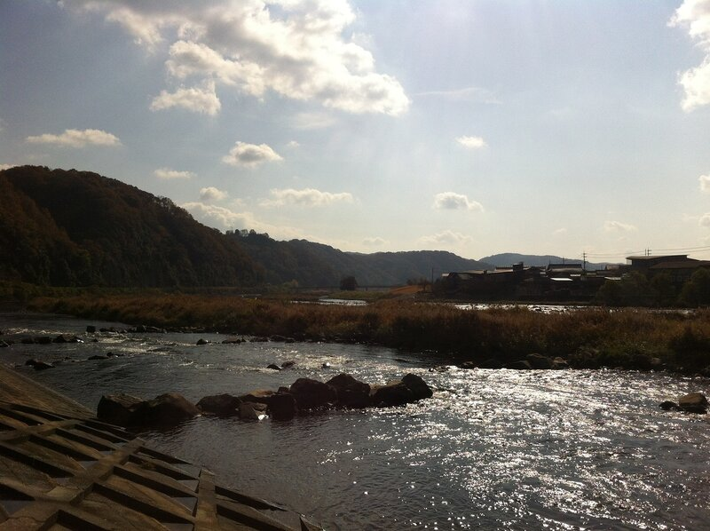

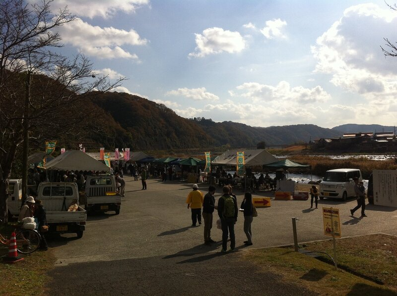

Можно купить овощей, фруктов, поесть свежеприготовленной еды: якитори — куриный шашлык на деревянной палочке, жареной рыбки, лапши соба ну или пончиков.

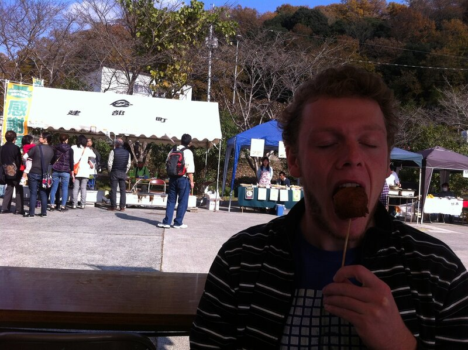

Посетители рынка в основном пожилые люди, настроенные очень доброжелательно. После нашего 15-ти минутного пребывания на месте, они немного привыкли к нам и начали просто подходить и давать нам еду бесплатно. Такие дела.

Ладно, едем дальше. По плану — горная речка и осмотр окрестностей.

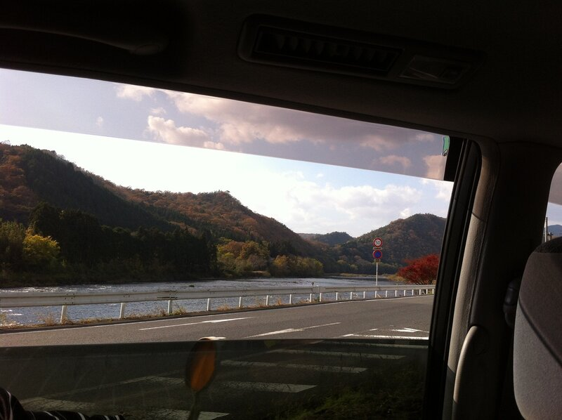

Забираемся в гору по отличной дороге, подъезжаем и останавливаемся у первого интересного места.

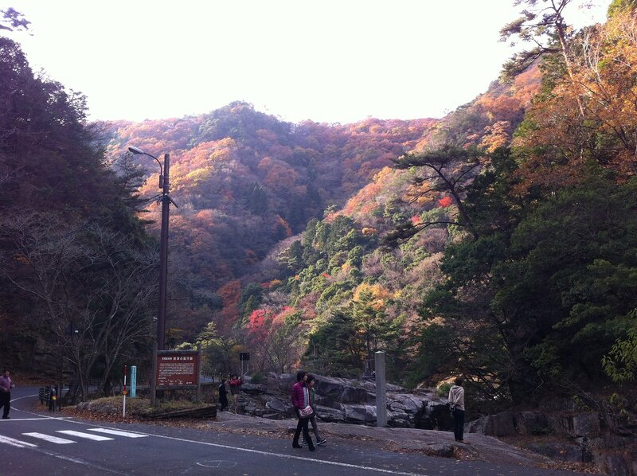

А вот и речка

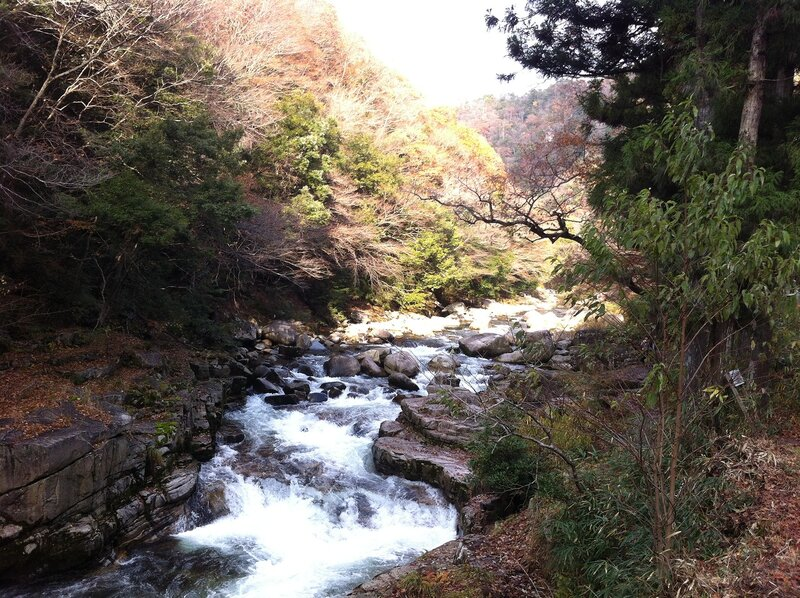

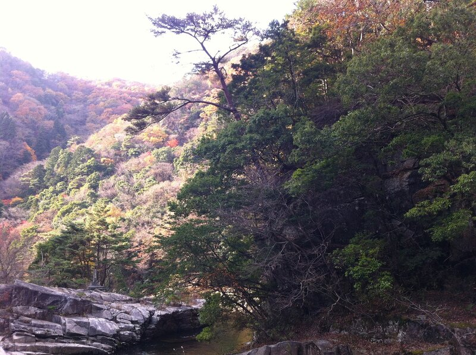

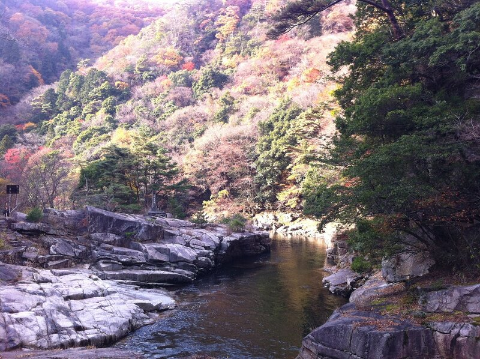

Немного группового фото

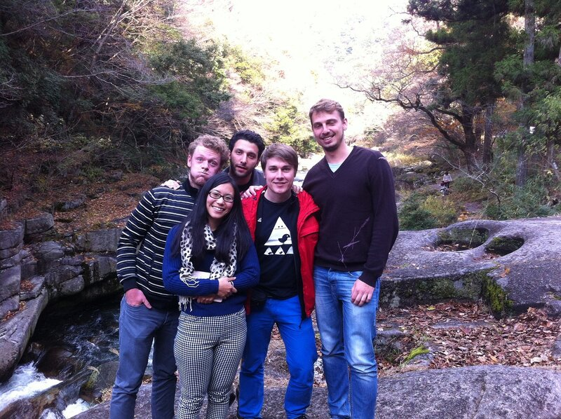

Спускаемся к воде

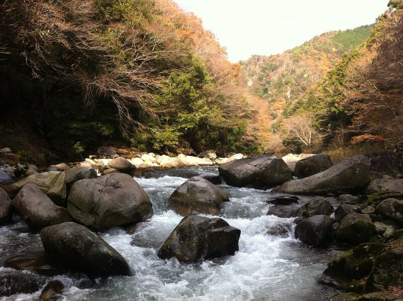

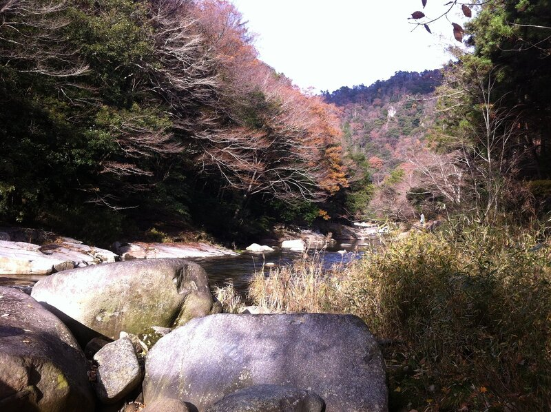

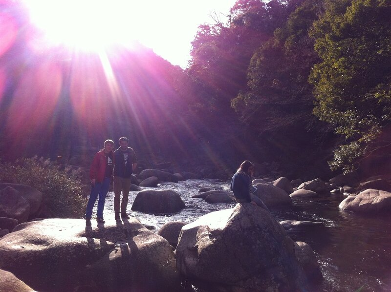

Далее один из спутников решил искупаться, даже несмотря на то, что вода в речке примерно 5-7 градусов. Подробности в видео в конце.

Следующий пункт — горная местность с небольшими торговыми рядами. Как обычно, делаем пару фоток, осматриваемся, покупаем понравившиеся вещи.

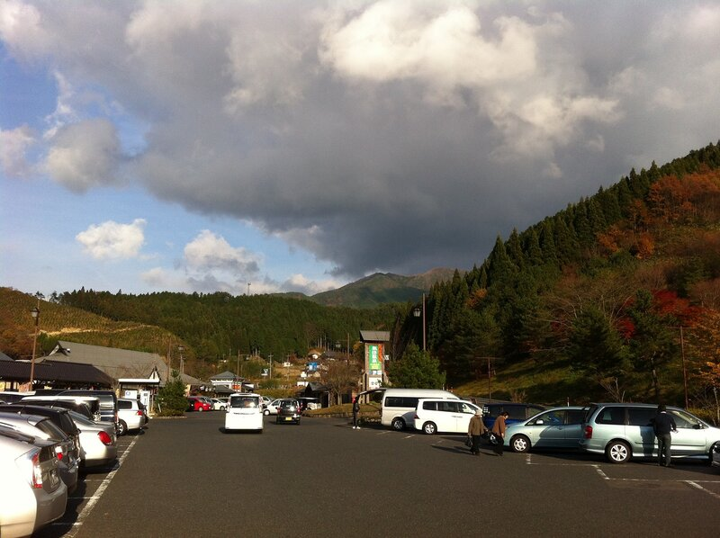

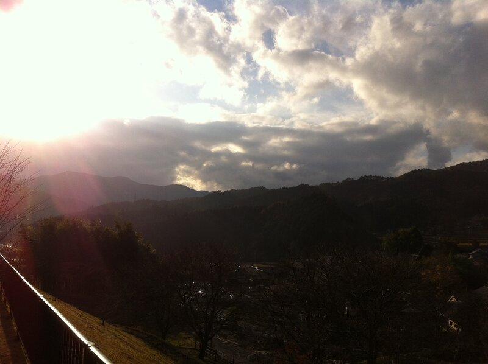

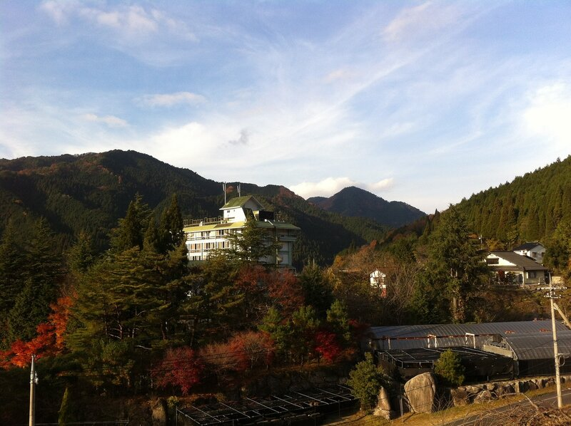

Темнеет, поэтому едем в соседний город Тсуяма, чтобы перекусить суши и затем отправиться в онсен.

[Онсен](https://ru.wikipedia.org/wiki/%D0%9E%D0%BD%D1%81%D1%8D%D0%BD) — горячий источник. Мы выбрали достаточно старый онсен под названием Юбара на открытом воздухе. Горячая вода поступает прямо из под земли и наполняет 3 небольших ванны. Фотографировать там запрещено, естественно. Зато кости погреть можно хорошо.

Маркус приобрел камеру gopro, и теперь к моим рассказам, по мере появления, я буду добавлять снятые и смонтированные им видео. Первое — очень удачное, на мой взгляд. Купание в речке, суши-поезд, красоты окрестностей и сумасшедшие танцы-зарядка на рынке:

<iframe src="https://player.vimeo.com/video/112890326?byline=0&amp;portrait=0" loading="lazy" allowfullscreen title="Видео"></iframe>

[Familientrip](http://vimeo.com/112890326) from [Marcus Pancakemeister](http://vimeo.com/user34829091) on [Vimeo](https://vimeo.com).
