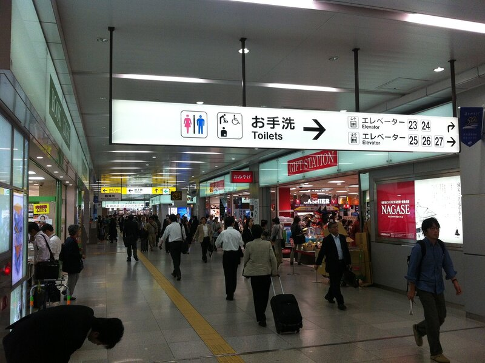
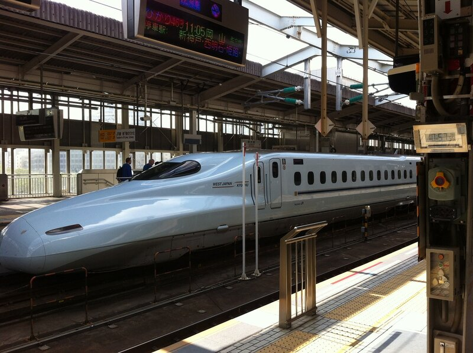
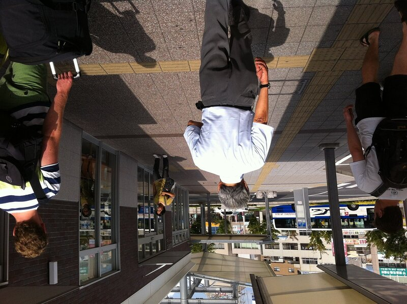
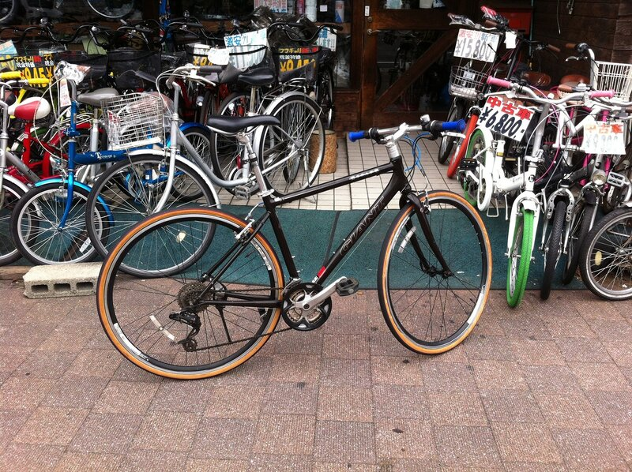
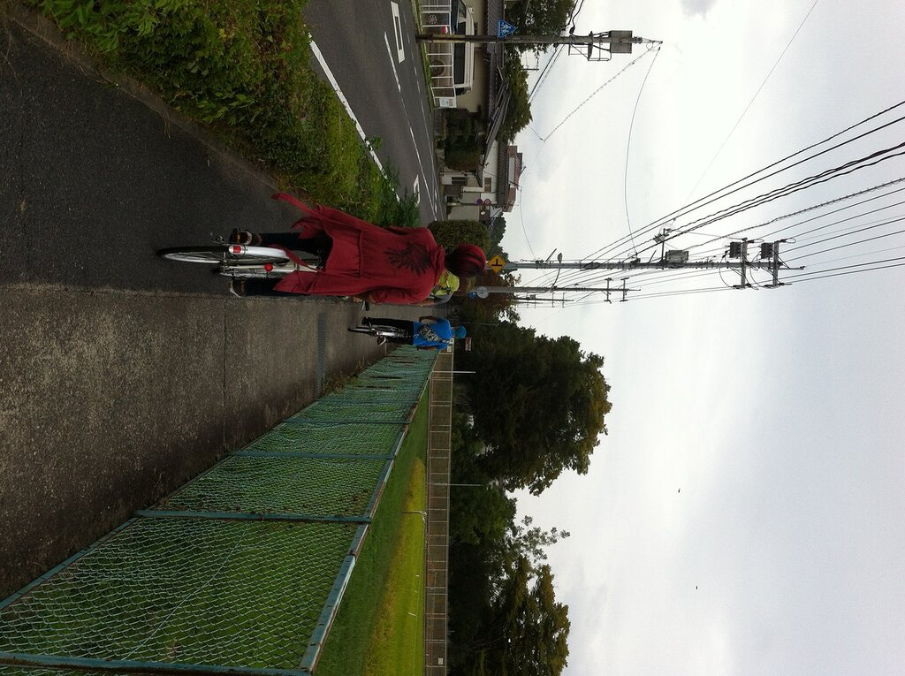
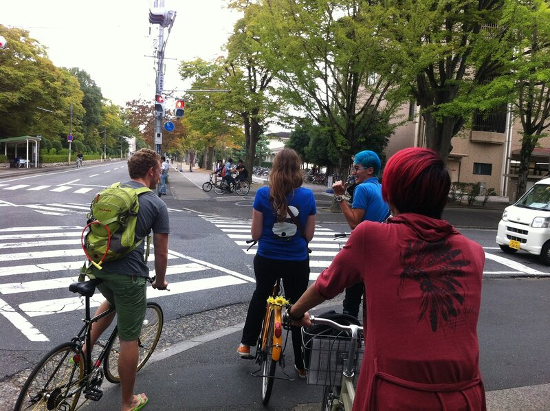
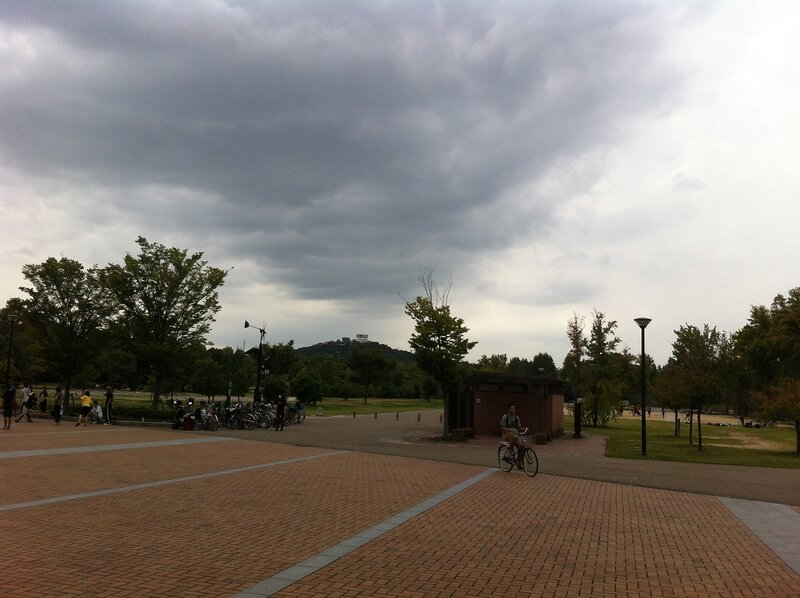
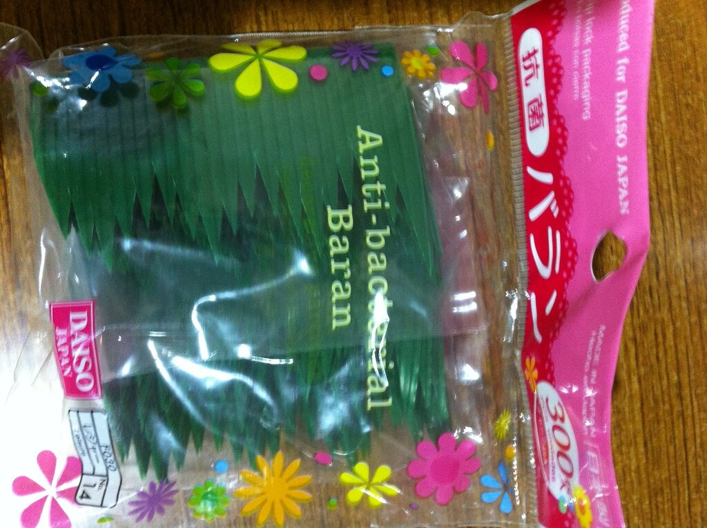

Наступил день отъезда из Осаки, и мы решили не мелочиться и взять самый быстрый поезд до Окаямы, где находится наш университет. Компания Шейхан предлагает прокатиться на скоростном поезде за 5500 йен, покрыв примерно 180 км за 45 минут. Добираемся до станции на метро, людей с утра полно, белый воротнички шныряют туда-сюда

Выходим на платформу, а там кому-то уже подали карету

Наш поезд подходит позже и мы спокойно добираемся до места, где нас встречает профессор и несколько немецких студентов, которые приехали по той же программе что и мы, только раньше на год или два. Некоторые из них остаются, чтобы дописать работу, поучить язык, или им просто нравится в Японии 🙂

Нас сразу же с вещами ведут обедать в какое-то кафе.

Далее фото будет не очень много, потому что все завертелось. Вкратце: нас отвозят в общежитие, мы кидаем вещи в комнаты и едем в офис в институте, где можно поторчать в середине дня, далее нас сразу ведут покупать велосипед, что занимает достаточно много времени, в основном из-за размеров наших тел: не велик выбор великов для больших дядей выше 185 см. Велосипед — действительно необходимая вещь в Окаяме, очень удобно и быстро можно передвигаться почти по всему городу. Мой темный рыцарь обошелся мне в 25000 йен

В 6 часов вечера мы приглашены на ужин с профессором, и я оказываюсь за столом с какими-то японскими студентами, которых, видимо, позвали за компанию, но они почти не говорят по английски, поэтому общение происходит на пальцах. Зато место очень хорошее — традиционный японский ресторан Якинику. В двух словах: тебе приносят сырое мясо и там его себе готовишь на плите, которая находится посередине стола. Не могу заставить себя фоткать еду, хотя в рамках научно-познавательного блога — стоит пересилить себя 🙂

В конце дня сил остается только на падение в кровать в общежитии. Кстати фотки его и описание — немного позже, нужно навести порядок.

Весь первый и второй день нам постоянно помогает Штефи, она приехала сюда по нашей программе год назад, и должна была по идее уже уехать обратно, но ей захотелось побыть здесь еще какое-то время. Она очень общительная, поэтому с утра, встречаясь у общежития, она натыкается на двух своих друзей, и мы вместе отправляемся в университет. Ага вот эти ребята

Справа, кстати, раскинулось рисовое поле. Прям рядом с общежитием.

Перекресток у въезда в университет.

Проводим какое-то время в университеты, улаживаем формальные вопросы. Дальше — в магазин за разными бытовыми принадлежностями.

Спортивный парк, небо темнеет

Закупаемся и едем обратно в наш новый дом. В 6 вечера намечается футбольный поединок всех желающих погонять, но погода меняет планы: начинается сильный дождь, мы приходим на место сбора, но нам предлагают сходить поесть лапши вместо долгожданного матча. Что ж, принимаем предложение, ужинаем с японскими ребятами огромным удоном за смешные деньги в каком-то заведении. Они активно пытаются практиковать английский, пока я воюю с непослушной лапшой и палочками. Пытаюсь узнать у них некоторые вещи, касаемо организации моего спортивного досуга, но мои уши пока еще не очень хорошо привыкли к японскому английскому, поэтому полезной информации удается добыть совсем немного.

Отправляемся в общежитие, где можно при входе порыться и забрать себе некоторые вещи, оставленные людьми выехавшими совсем недавно. Этими штуками обычно разделяют один вид суши от других на тарелочках. Название звонкое

За два дня произошло достаточно много событий, я и не сумел запечатлеть и малой части: либо надо было быть внимательным и слушать, либо устал от внимательности и лень напрягаться и что-либо делать, либо забыл телефон. Буду работать над собой 🙂
