Как это обычно происходит, в первые дни после переезда нужно слишком много сделать и организовать, поэтому в голове сейчас небольшая каша из событий последних нескольких суток. Поэтому просто постараюсь немного рассказать по пунктам.

Общежитие

По сути это и не общежитие вообще, потому что единственное общее на каждом этаже — 2 стиральных машины. У каждого человека есть своя, по сути, квартира с ванной, туалетом, небольшой кухней, мебелью и интернетом. Состояние квартиры напрямую зависит от предыдущего жильца, к сожалению, мою новую жилплощадь необходимо было слегка отмыть.

Вид с небольшого балкончика: слева — горы, справа — рисовое поле и вдалеке высокие здания собственно университета.

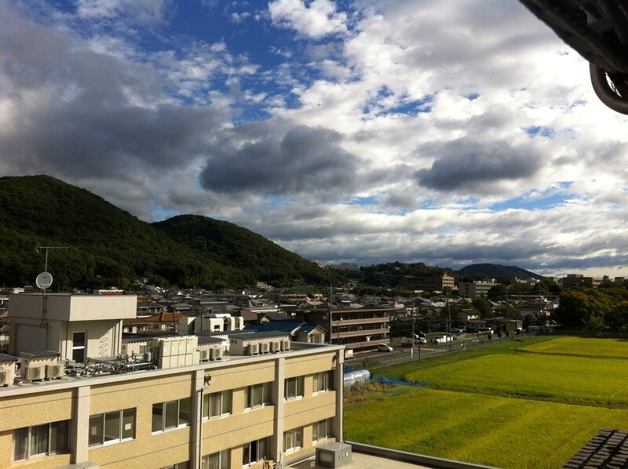

Центрального отопления нет, зато есть кондиционер. Горячая вода нагревается отдельным бойлером.

У японцев своеобразное отношение к мусору: ладно, что мусорки — очень редкий экземпляр, который встречается строго около продуктовых магазинов, да и то не всегда. Более того, проживая в общаге, можно сдать свой сжигаемый мусор (все биоотходы и упаковку) строго в прозрачных пакетах в понедельник и четверг с 8 до 9 утра. Причем, не то чтобы мусоровоз приезжает, совсем нет, они только на это время открывают клетку напротив главного входа и принимают пакеты с мусором. В другое время — коллекционируй мусорок у себя, поджидая заветный час. Может им подсказать, что можно сделать специальный ключ от клетки и дать его обитателям общежития? Даж не знаю.

Университет

Японцы довольно-таки трепетно относятся к иностранцам в институте: как я понял, для них это достаточно престижно, когда есть студенты из других стран, тем более, пока таковых тут не так много. А все из-за того, что на английском, к сожалению, преподаются только спецкурсы для американских студентов и японский язык. Профильные предметы по моей специальности — строго на японском. Преподаватели готовы идти на встречу и помогать с материалом на английском. Будет тяжко, но прорвемся.

Лекция

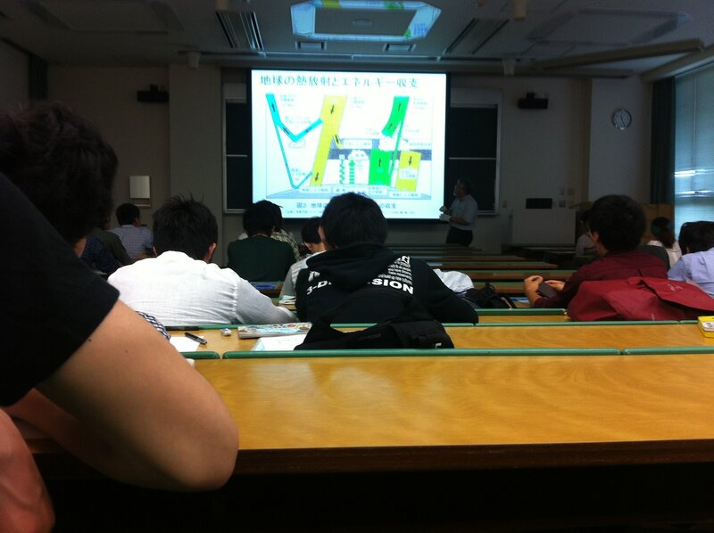

Семинар например

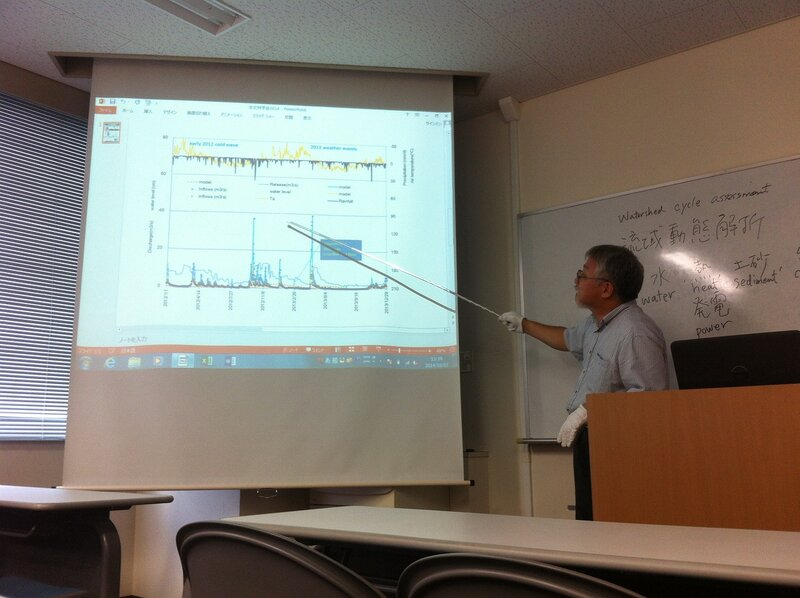

Немного территории университета

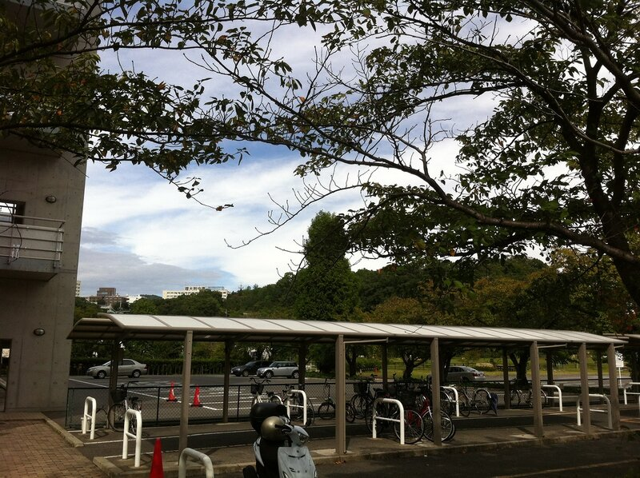

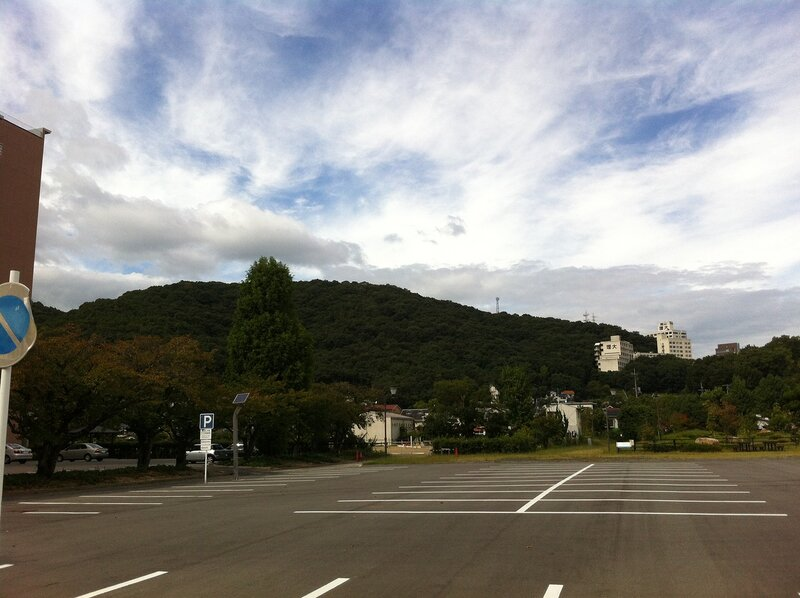

В субботу было организовано небольшое собрание для новых студентов: объясняли, что можно, нужно и нельзя. Тур по территории универа

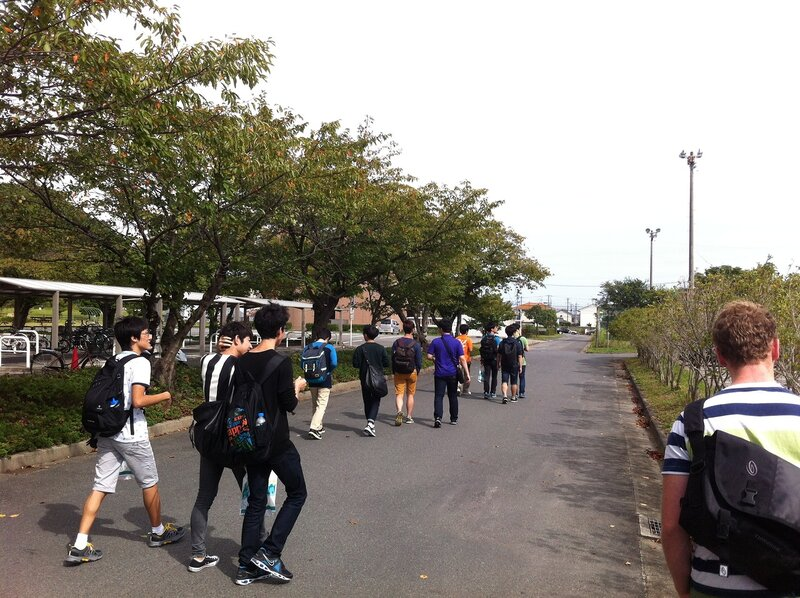

Агитация вступить в студенческую организацию

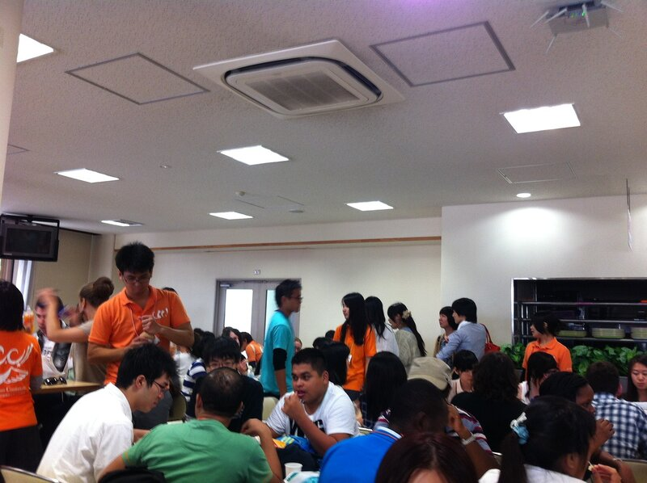

Нужно время, чтобы понять, как тут дела делаются и привыкнуть.

Свободное время

Местные студенческая организация пытается сделать так, чтобы нам не было скучно, организуя небольшие мероприятия. После футбола в пятницу, народ обычно сразу идет поужинать.

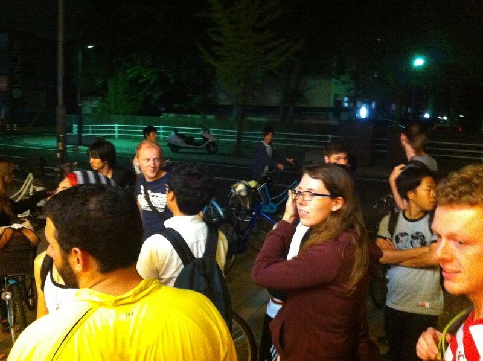

Также периодически бывают питейные вечеринки. Выглядит примерно так: затариваешься алкоголем и идешь в парк. После парка любимое время препровождение японцев — караоке.

Ну пока свободного времени было не так много.

Еда

Ясное дело, база для всех японских блюд — рис, дальше уже вариации на то, что идет вместе с ним. Есть еще лапша, очень неплохая. Вообще еда достаточно вкусная. Всегда можно купить бентобокс — обычно это рис и курица/рыба в пластиковой коробке, стоит ~4 евро.

Фрукты в магазинах очень дорогие, дороже, чем во всех местах, которых я бывал прежде, что, естественно, расстраивает.

В студенческих столовых, которых в кампусе 3, кормят вполне неплохо, стоимость нормального обеда 4-6 евро. Поел — всполосни за собой тарелочку. Не понимаю, зачем, ведь ее все равно потом моют, но это — Япония.

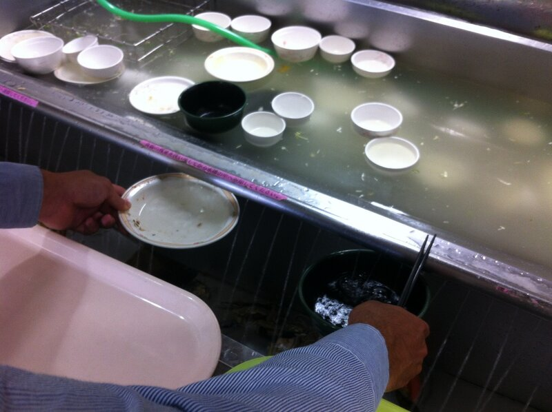

В воскресение ходили в местечко, где подают суши. Это то самое, в котором суши крутятся на ленте по кругу и ты можешь брать любую понравившуюся тарелочку. Платишь потом за количество тарелок, которые опустошил =) Можно заказать из меню, если не нашел ничего вкусного на ленте, но такое вряд ли случится

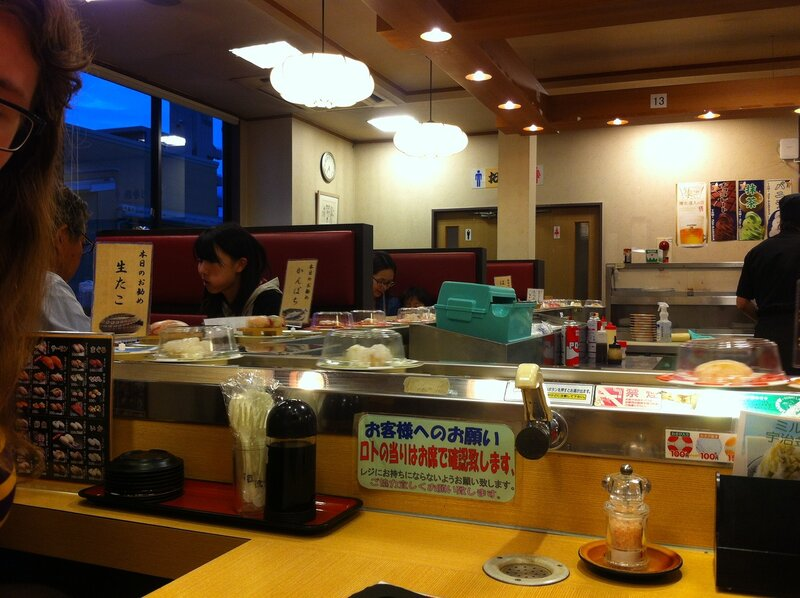

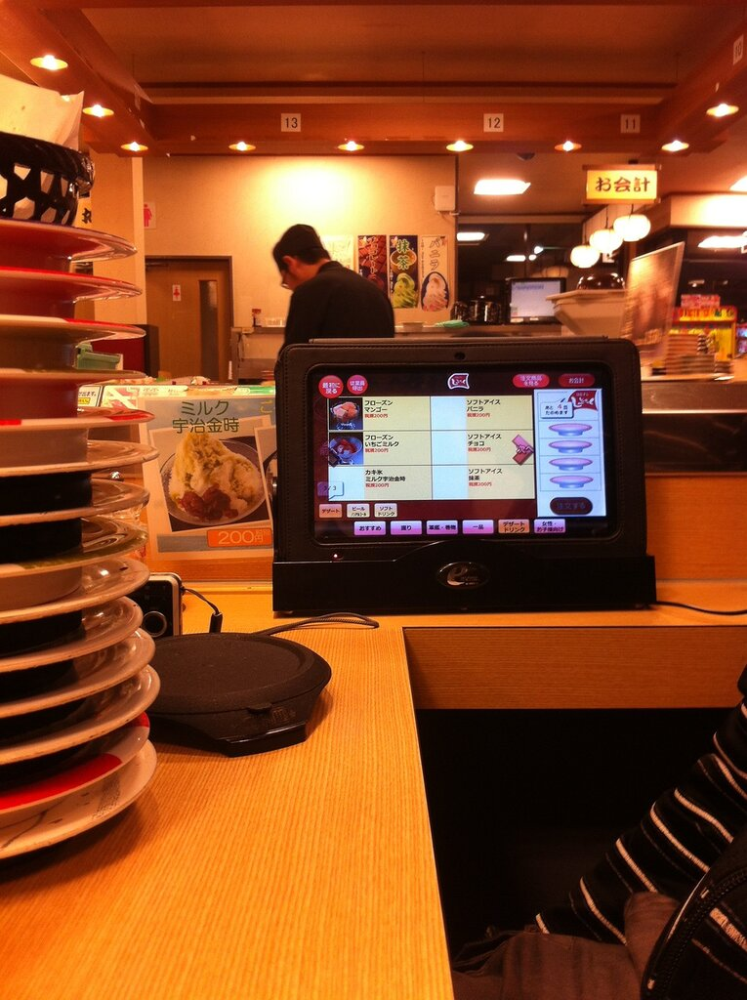

Суши в этом месте вкусные, вероятно, из-за того, что рыба свежая. Средний счет получился 10-15 евро.

Еще одна особенность, что во многих заведениях можно пить зеленый чай или воду в любых количествах бесплатно.

Окаяма — спокойный небольшой городок. Уже начинаю привыкать, что местные жители, увидев меня в магазине, рассматривают или могут просто уставиться надолго. Человек с европейской внешностью и достаточно высоким ростом в этих краях — не очень обычное явление.

Более менее русскоговорящего человека я встретил тут пока только одного: американец по имени Грэгори немного изучал великий и могучий в университете Огайо, может связать пару фраз, зарабатывает тут преподаванием английского местным детям.

Посмотрим, что будет дальше.
