Путешествие сильно измотало, поэтому высыпались мы долго и проснулись сегодня в 14.30 по местному времени. Кстати, разница с Москвой +5 часов. Решили, что сегодня не будем усердствовать в изучении достопримечательностей, пощелкаем лицами в окрестностях хостела. Маркус захотел купить фотоаппарат, поэтому сначала идем в торговые центры неподалеку. Выходим из хостела

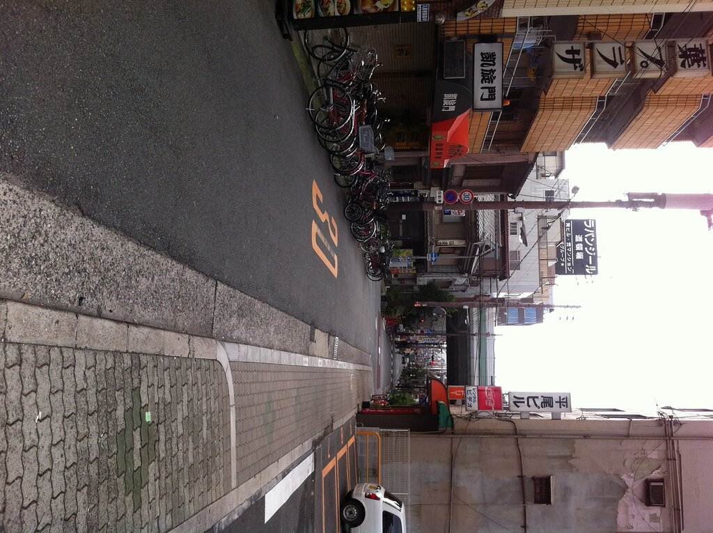

Как обычно в больших городах, дороги расползаются в разных направлениях.

Логотип сетевого супермаркета напомнил немецкого ампельмана.

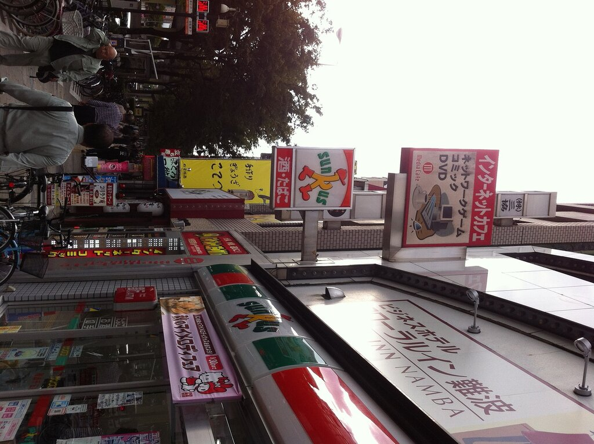

Наконец, мы на месте, бесчисленное количество домов объединено крышами, что создает ощущение огромного здания. Через каждые 5 шагов попадаются казино, причем плотно заполненные людьми, и непонятные магазины с картинками аниме. Не знаю как все — а мы Макдональдс позавтракать.

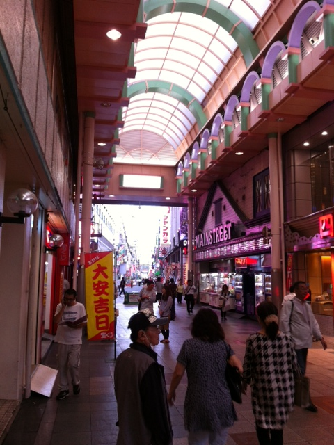

Но нас интересует магазин с техникой, и мы находим его неподалеку. На первом этаже 6-ти этажного сетевого магазина техники торговля кипит, только вот у стенда с шестыми айфонами почему-то пусто. Может по-японски цены не могут разобрать 🙂

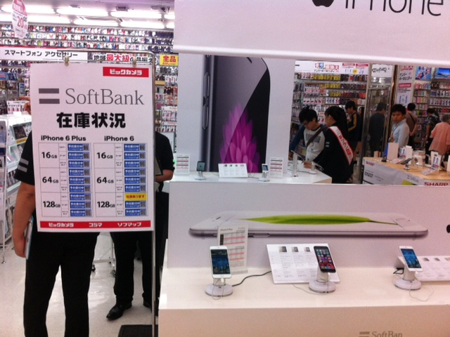

На одном из этажей находим отдел с фотиками, Маркус выбирает бюджетный, но неплохой на вид Олимпус, стоимостью в пределах 100 Евро. Услужливые продавцы помогают с покупкой, и мы готовы идти дальше.

Над головой постоянно нависают конструкции дорожных и жд развязок.

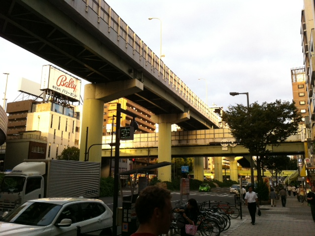

Просто идем прямо по дороге. Напомнило обычный перекресток в любом городе.

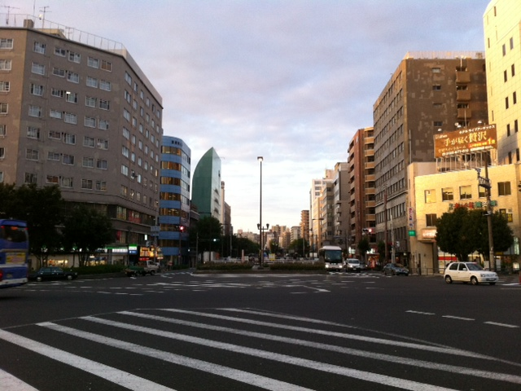

Полицейский запрещает парковку, видимо, ну или хочет обнимашек

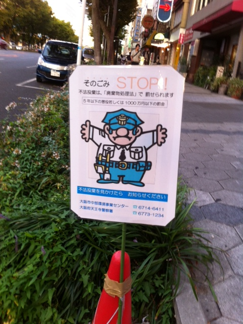

Начинает темнеть, и мы понимаем, что выходим из центра и надо возвращаться обратно. Тем временем, знакомая вывеска. Вероятно, эта сеть супермаркетов работает по все юго-восточной азии, ибо такая же наблюдалась в Тайланде. А что, звучит клево: севен-илевен

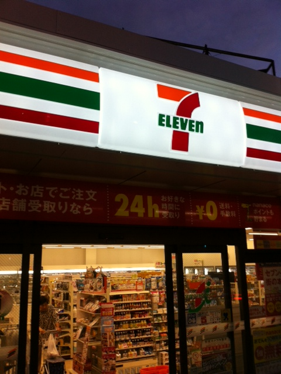

Далее проходим мимо салона-ресторана, в котором можно постричь своего питомца и, возможно, заказать ему еду. А может просто поесть в окружении собак или покормить их. Народу в нем много, и один обитатель выбегает к витрине и передает нам привет. Ну что ж, привет, Джеки!

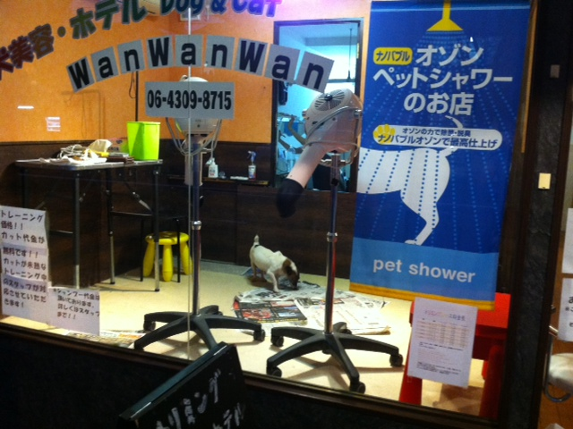

Следующее заведение точно как-то связано с детьми. Хотя игрушка у входа выглядит довольно странно, напомнило клоуна из Пилы. А, чуть не забыл, мы ж в Японии.

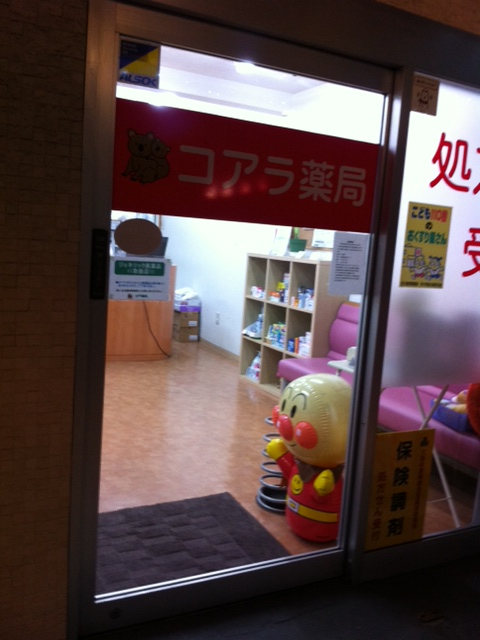

Доходим до ближайшей станции метро и возвращаемся в хостел.

В метро заботливо расклеены предупреждающие стикеры.

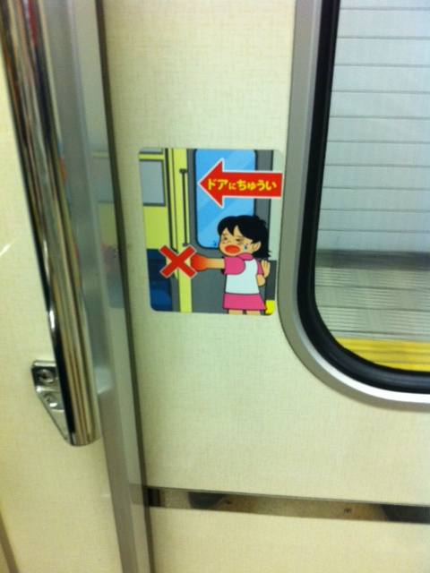

Заходим в супермаркет и двигаемся отдыхать, о магазинах и еде потом напишу. Завтра будет насыщенный день, нужно много где побывать.
