Давно ничего не писал. Попробую исправить, но о Японии больше не будет совсем. Будет об Америке.

Начну с небольшого предисловия. С недавнего времени живу в столице шатата Северная Каролина — Роли. Хожу в университет NC State. Изучаю качество воды местного эстуария реки Ньюс — однорукавного, воронкообразного [устья](https://ru.wikipedia.org/wiki/%D0%A3%D1%81%D1%82%D1%8C%D0%B5) [реки](https://ru.wikipedia.org/wiki/%D0%A0%D0%B5%D0%BA%D0%B0), расширяющегося в сторону [моря](https://ru.wikipedia.org/wiki/%D0%9C%D0%BE%D1%80%D0%B5). Цель — смоделировать некоторые параметры: концентрацию кислорода или [планктона](https://ru.wikipedia.org/wiki/%D0%9F%D0%BB%D0%B0%D0%BD%D0%BA%D1%82%D0%BE%D0%BD) в воде. Зная их, можно давать рекомендации и прогнозы по состоянию водного объекта управляющим госорганизациям. Это делается для сохранения животного и рыбного мира и защиты локальной [экосистемы](https://ru.wikipedia.org/wiki/%D0%AD%D0%BA%D0%BE%D1%81%D0%B8%D1%81%D1%82%D0%B5%D0%BC%D0%B0) от человеческого воздействия. Ну рыбки же умирают почему-то, и надо это предотвратить!

В Штатах достаточное внимание уделяется экологическим проблемам, и это нормальная практика развитых стран. Ведется постоянный мониторинг крупных водных объектов. Например, данные для моей работы собираются более 20 лет проектом [Модмон](http://www.unc.edu/ims/neuse/modmon/water_quality.htm). Раз в две недели катер выходит в воды эстуария и забирает пробы в одних и тех же точках. Так образовывается база данных, которую можно анализировать и использовать для построения различных моделей — приближенного описания природных процессов. Данные — наше всё.

Осенью мне удалось побывать на одном из круизов: покататься на катерке по заливу, пособирать сэмплы и позагорать. В Северной Каролине мягкий климат, поэтому октябрьская погода очень похожа на июль средней полосы России. Листья только начинают опадать.

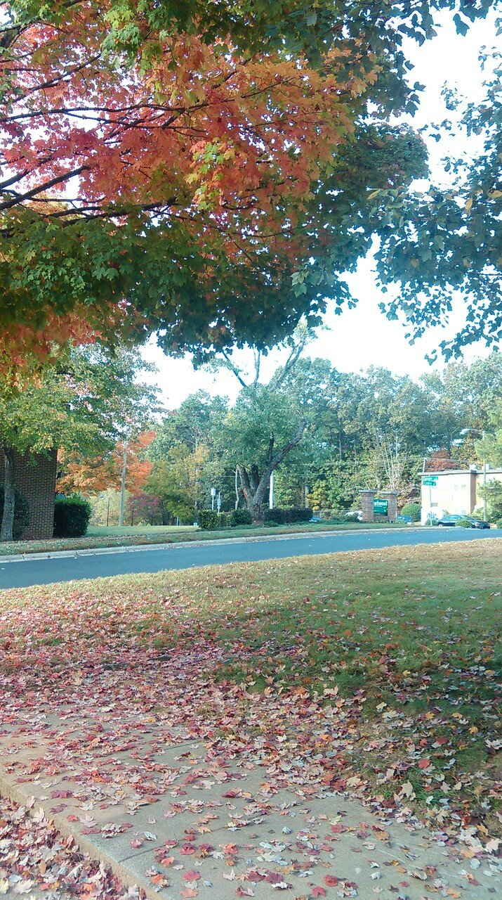

Залив находится примерно в двух часах езды от моего дома в Роли. Место встречи — небольшой парк в городе Нью Берн. Круиз начинается в 8 часов утра, поэтому проснуться пришлось пораньше.

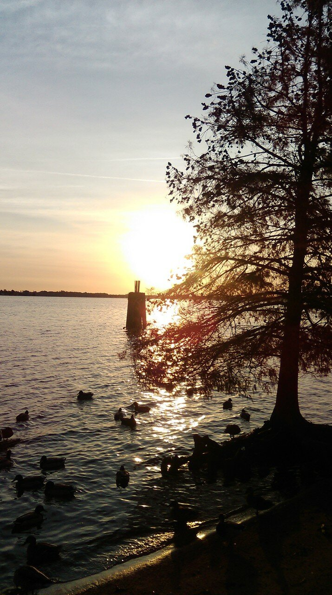

Из посетителей парка — утки и несколько ранних бегунов

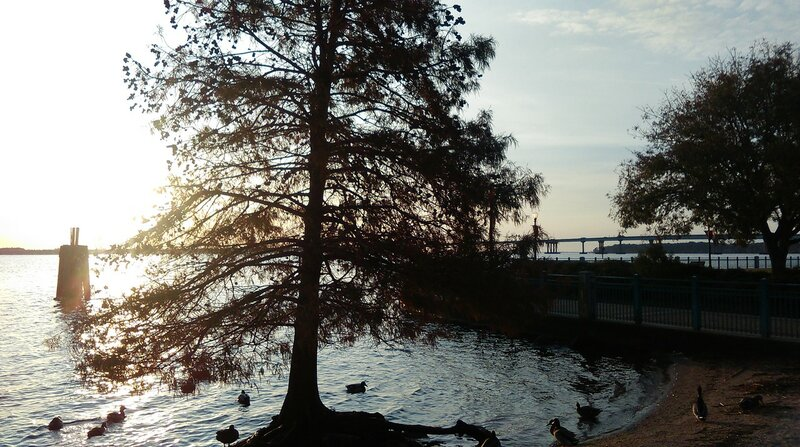

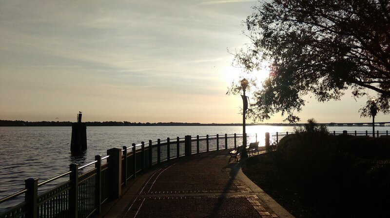

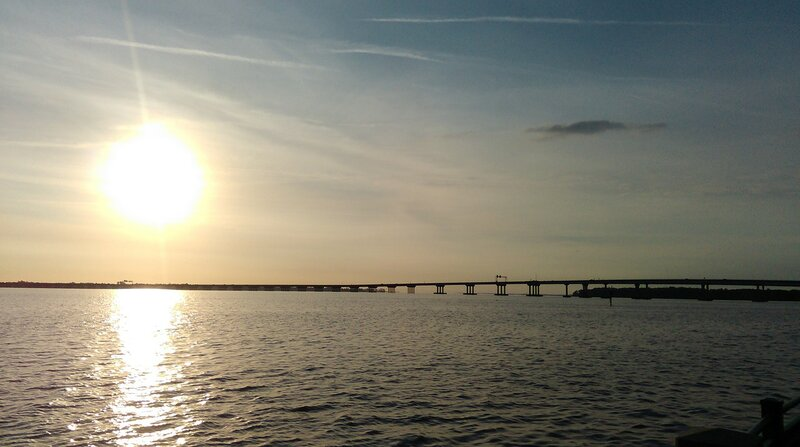

Катер прибуксировали на грузовичке, быстро спустили на воду и отплыли. Обычно маршрут выглядит так: сначала катер добирается до самых дальних станций — они далеко в заливе, примерно 50 км от стартовой точки. Затем лодка движется в обратном направлении — и доходит дотаточно далеко вверх по течению. В том месте Ньюс выглядит как обычная речка.

Старт

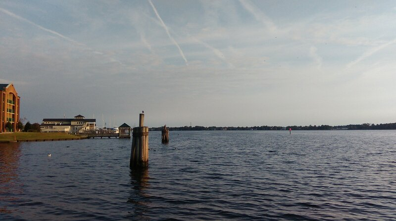

Весь круиз занимает примерно 6 часов. На то, чтобы добраться до дальней станции уходит примерно час. Катер гонит со скоростью 50 км/ч, против волн. Чем ближе открытое море — тем больше тряска. Хорошо, что позавтракал 3 часа назад.

На катере обычно работает 2 человека: один собирает пробы химического состава воды, которые потом анализируют в лаборатории.

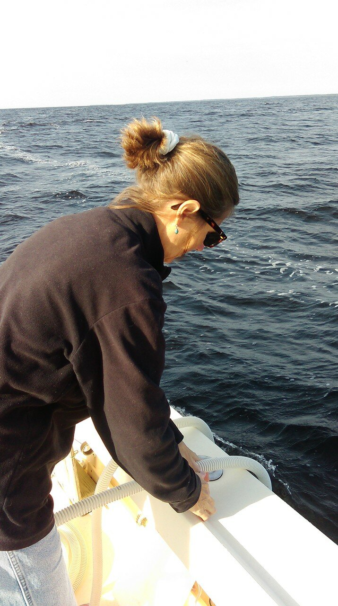

Второй измеряет физические параметры воды (температуру, проводимость) и уровень кислорода каждые полметра пока не дойдет до дна. Таким образом можно оценить вертикальный срез или профиль. На фото видно, как с помощью кронштейна датчик постепенно опускается вниз

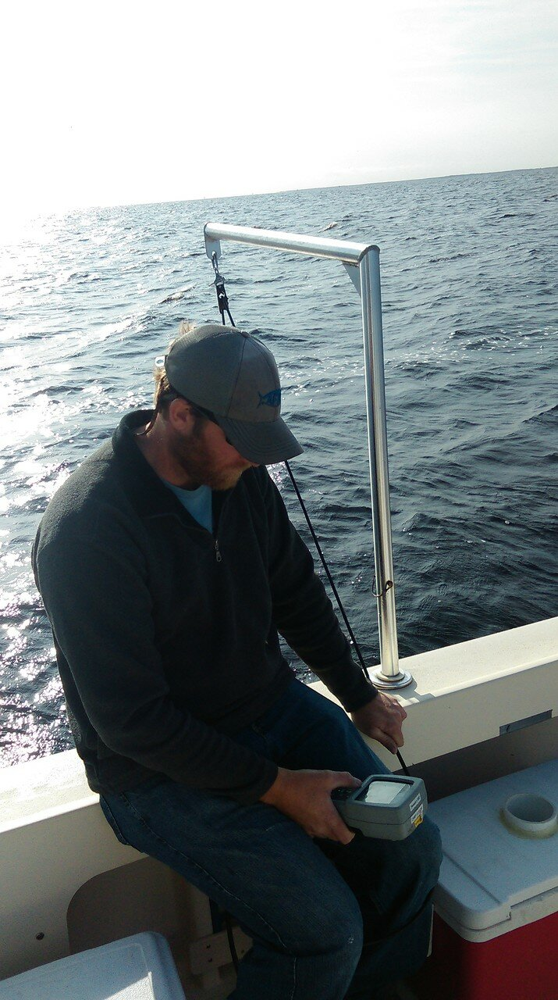

Делов-то, казалось бы. Но это долгая монотонная работа. Плюс, погода не всегда такая хорошая. На дальней точке уже почти обычное море с качкой и морским ветром

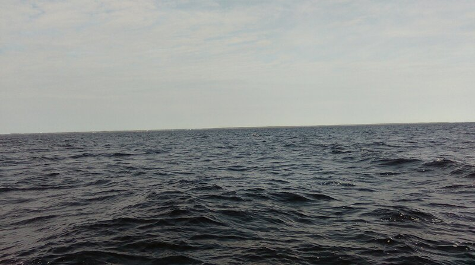

По мере движения вверх по заливу, ветер становится слабее, куртки сбрасываются. Вода становится холоднее. Морская же прогрета после лета. Этот круиз состоялся как раз после урагана, которые частое явление на восточном побережье США.

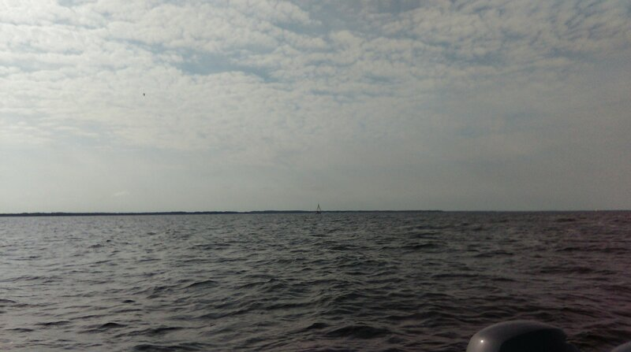

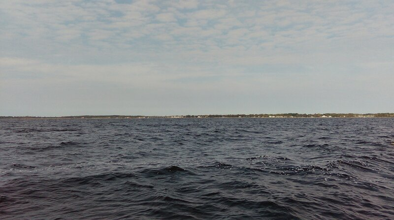

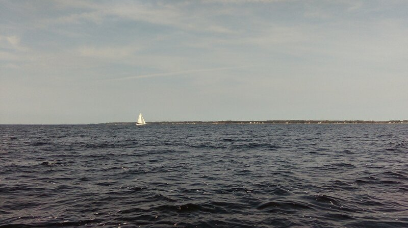

Оцените разницу: это фото уже где-то в середне залива, на полпути обратно

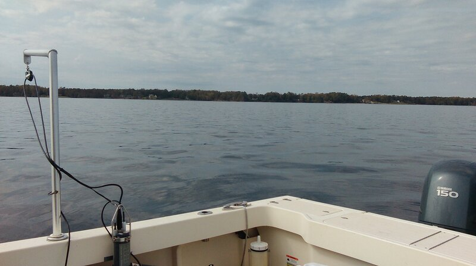

И вот еще

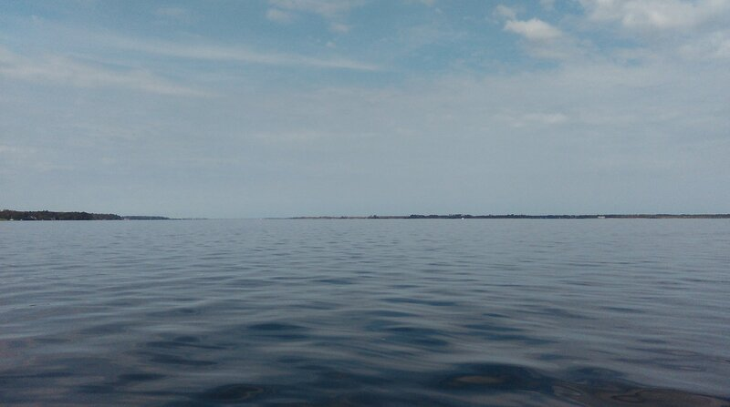

Ну пруд же почти — тишь да гладь

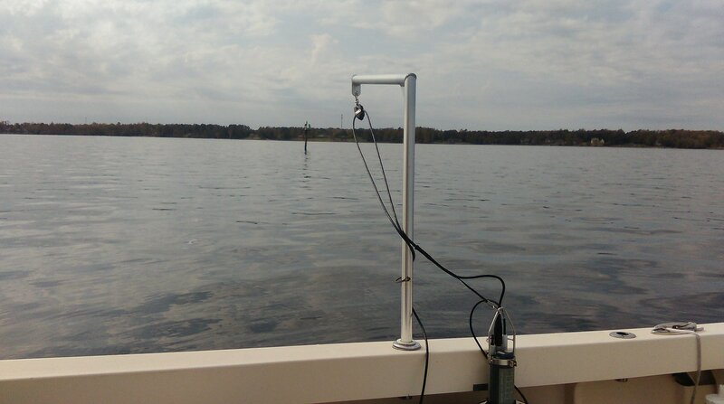

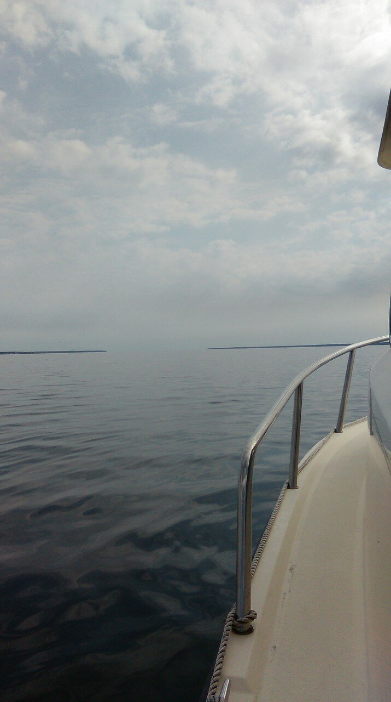

Тот же мост, который было видно на одной из первых фоток, только с другой стороны

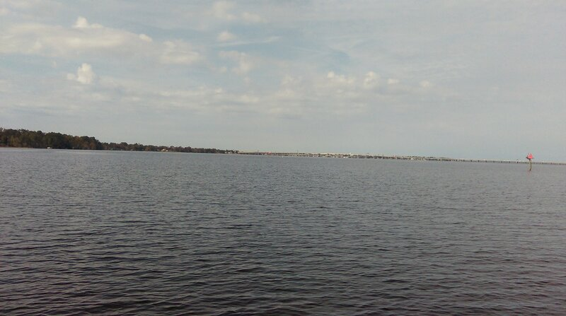

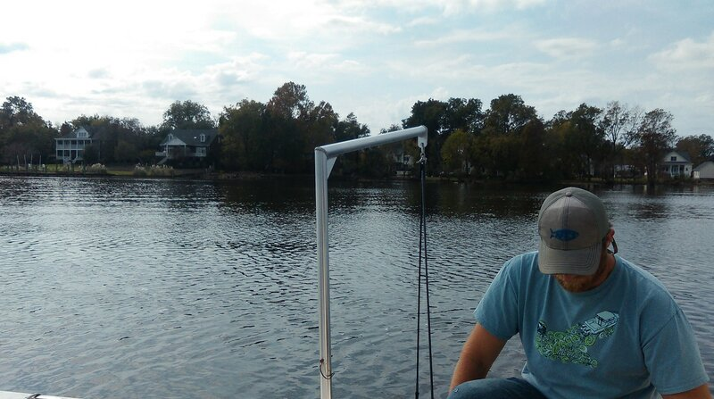

Здесь волн нет, и можно прибавить ходу

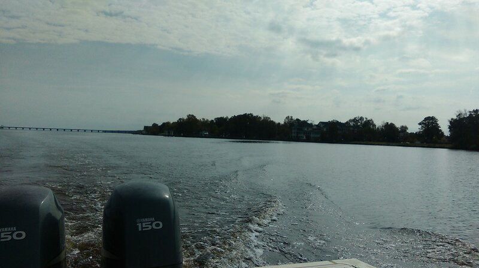

Последняя точка сбора проб: сложно поверить, что эта речушка через пару десятков километров превратится в огромный резервуар и растворится в море

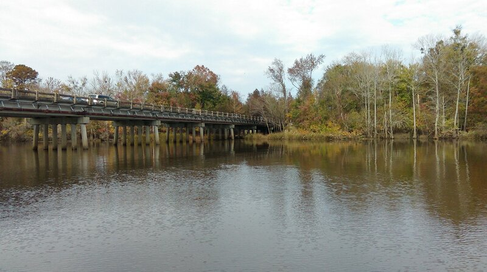

Однако это так

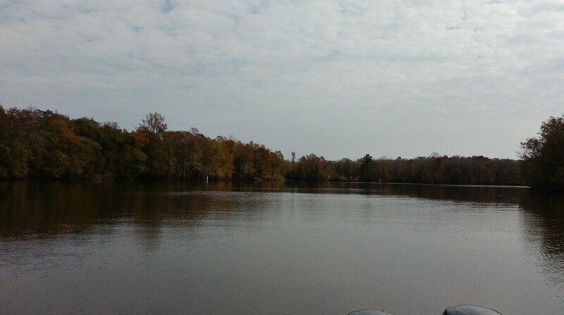

Логичным будет объяснить, зачем вообще всё это: зачем мерить кислород в воде, откуда планктон берется, как вообще происходит загрязнение воды и почему это плохо. Как-нибудь потом.
